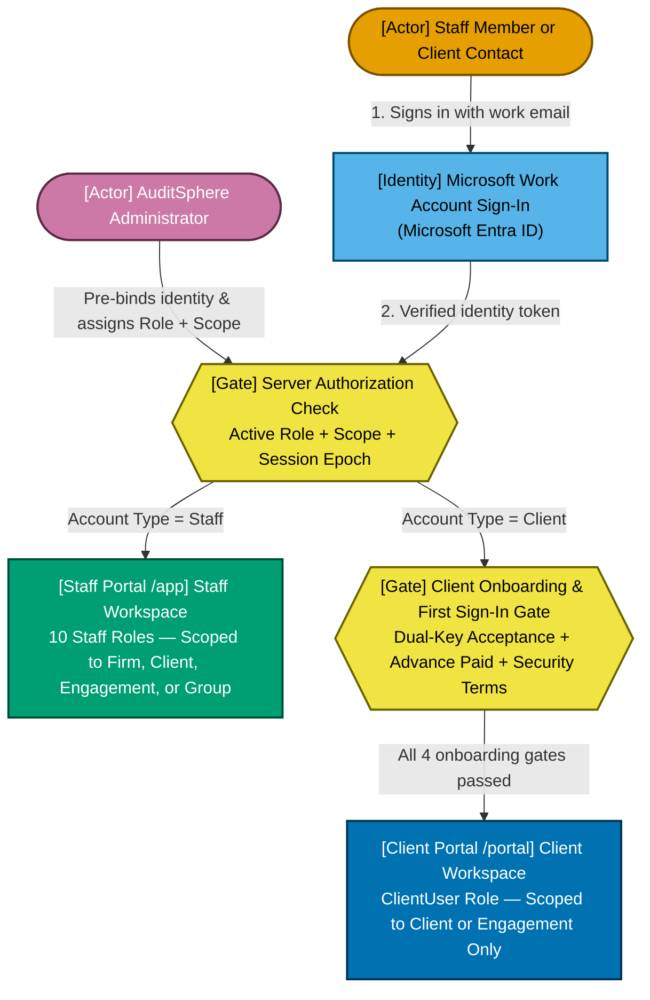
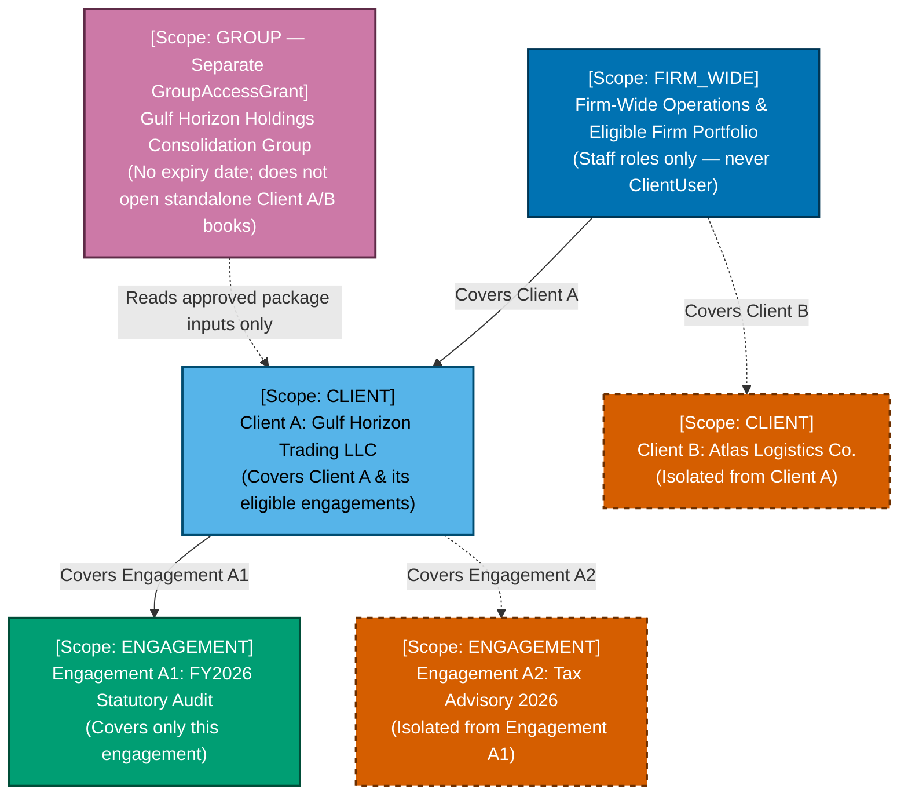
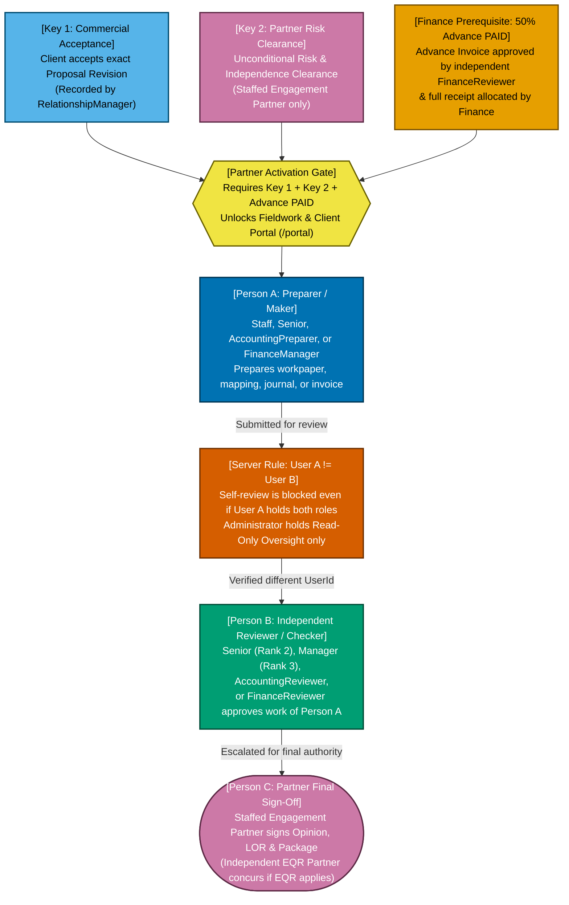
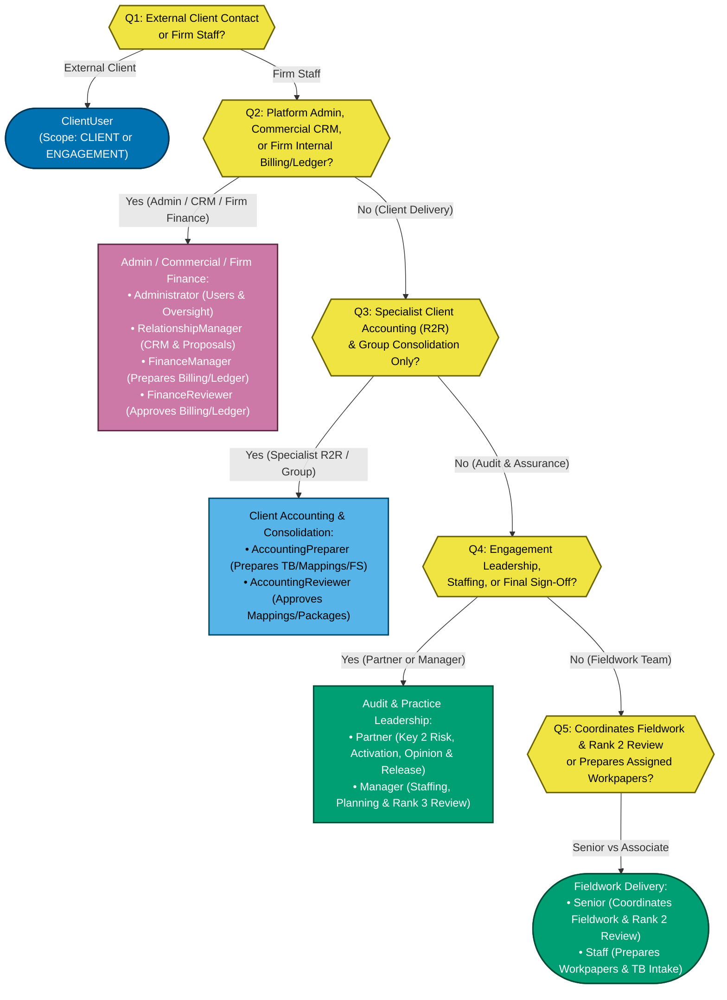
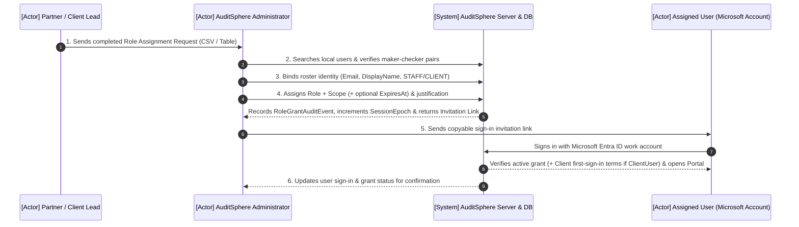

# AuditSphere Roles & Access — End-User Guide

> **Document Classification:** `CURRENT` — End-User & Administrator Access Guide  
> **Companion Request Template (CSV):** [`auditsphere-security-template-role-assignment-request.csv`](auditsphere-security-template-role-assignment-request.csv)  
> **Self-Contained Shareable HTML Edition:** `docs/security/auditsphere-security-guide-user-roles-and-access-current.html`  
> **Architectural Authority:** [`auditsphere-architecture-user-roles-and-privileges-current.md`](../architecture/auditsphere-architecture-user-roles-and-privileges-current.md)

---

## Table of Contents

1. [What we need from you](#1-what-we-need-from-you)
2. [60-second overview](#2-60-second-overview)
3. [Role plus scope](#3-role-plus-scope)
4. [Role cards (all 11 assignable roles)](#4-role-cards)
5. [Who does what across the engagement lifecycle](#5-who-does-what-across-the-engagement-lifecycle)
6. [Approvals and separation of duties](#6-approvals-and-separation-of-duties)
7. [Role vs capability matrix](#7-role-vs-capability-matrix)
8. [Which role should this person have?](#8-which-role-should-this-person-have)
9. [How to fill in the request form](#9-how-to-fill-in-the-request-form)
10. [What happens after you reply](#10-what-happens-after-you-reply)
11. [Changing or removing access](#11-changing-or-removing-access)
12. [Frequently Asked Questions (FAQ) and Glossary](#12-frequently-asked-questions-faq-and-glossary)
13. [Appendices (Administrator Walkthrough & Evidence Map)](#13-appendices)
    - [Appendix A: Administrator Walkthrough (`Users & Access`)](#appendix-a-administrator-walkthrough-users--access)
    - [Appendix B: Source Evidence Map, Non-Assignable Codes & Open Questions (`TO CONFIRM`)](#appendix-b-source-evidence-map-non-assignable-codes--open-questions-to-confirm)

---

## 1. What we need from you

> ### Action Required: Send Us Your Role Assignment List
>
> After reading this 10-minute guide, please send us the **exact Microsoft sign-in work email address** for each person in your firm or client finance team who needs access to AuditSphere, along with the **role** and **scope** they should hold.
>
> - **Template to use:** Complete the table in [Section 9](#9-how-to-fill-in-the-request-form) or the companion spreadsheet [`auditsphere-security-template-role-assignment-request.csv`](auditsphere-security-template-role-assignment-request.csv).
> - **Where to send your completed list:** `[insert recipient email / secure onboarding inbox, e.g., auditsphere-access@example.com]`
> - **Target reply deadline:** `[insert target date, e.g., DD Month YYYY by 17:00]`
> - **Golden rule before sending:** Every person who prepares work (audit procedures, accounting mappings, adjustment journals, financial packages, or firm invoices) **must have a different person** assigned to review or approve that work. One person cannot approve their own preparation, even if you request two roles for them.

---

## 2. 60-second overview

AuditSphere has **two separate workspaces (portals)**:

1. **The Staff Workspace (`/app`):** Used by your audit, accounting, commercial, finance, and administration teams to manage clients, plan engagements, prepare and review working papers, run client accounting and group consolidations, and manage firm billing.
2. **The Client Portal (`/portal`):** Used exclusively by external client contacts (such as a client Finance Director or Chief Accountant) to answer **Provided by Client (PBC)** information requests, upload supporting documents, review proposed management adjustment journals, and acknowledge management financial packages.

Every user signs in with their **Microsoft work account (Microsoft Entra ID)**—AuditSphere does not keep separate passwords. Signing in with Microsoft proves *who* the person is, but grants **zero access on its own**. An AuditSphere **Administrator** must record a **Role Grant** that combines a **Role** (what they are allowed to do) and a **Scope** (which clients, engagements, or groups they are allowed to touch). Every screen, button, and document download is checked by the server against that active grant.

### Diagram A: How Sign-In, Role Grants, and the Two Portals Fit Together

*Alt text: Vertical flow diagram showing a user signing in with a Microsoft work account, the AuditSphere server checking their active Role Grant (Role plus Scope) assigned by an Administrator, and routing Staff accounts to the Staff Workspace and Client accounts to the Client Portal after onboarding gates clear.*

*Caption — Diagram A: Microsoft sign-in verifies identity; the AuditSphere server checks the Administrator-assigned Role and Scope before opening either the Staff Workspace or the Client Portal.*

---

## 3. Role plus scope

When you request access for someone, you always answer two questions:

1. **Role — "What job do they do?"** (for example, `Manager`, `Senior`, `AccountingPreparer`, `FinanceManager`, or `ClientUser`).
2. **Scope — "Where are they allowed to do that job?"**

AuditSphere enforces **four distinct scopes**. A broader scope does not automatically unlock separate specialist areas, and a narrow scope strictly walls off every other client or engagement.

| Scope Code | Plain-English Meaning | Concrete Example | What It Does **Not** Cover |
|---|---|---|---|
| **Firm-wide** (`FIRM_WIDE`) | Across your firm's eligible records for that specific role. Required for firm-level administration, firm ledger books, and CRM pipeline management. | Amira is a `Partner` with `Firm-wide` scope, or Omar is an `Administrator` with `Firm-wide` scope. | Does **not** grant access to another firm, does **not** grant extra roles, and does **not** automatically unlock `Group` consolidation unless a group grant or firm-wide consolidation check applies. Never allowed for `ClientUser`. |
| **Client** (`CLIENT`) | One specific client company and its engagements (where the action accepts client-level coverage). | Tariq is granted `Manager` on **Client: Gulf Horizon Trading LLC**. He can manage and review Gulf Horizon's engagements. | Cannot see or act on any sibling client company or firm-wide administration/ledger screens. |
| **Engagement** (`ENGAGEMENT`) | One single audit or accounting project for a client. The server automatically resolves the parent client link from stored database records. | Lina is granted `Senior` on **Engagement: Gulf Horizon FY2026 Statutory Audit**. | Cannot see Gulf Horizon's FY2025 engagement or any other project for the same client. |
| **Group** (`GROUP`) | One corporate consolidation group (stored as a separate `GroupAccessGrant`) for multi-entity consolidated financial statements. | Youssef is granted `AccountingPreparer` on **Group: Gulf Horizon Holdings Group**. | Does **not** grant access to the standalone books of the subsidiary clients, cannot be assigned to `Senior`, `RelationshipManager`, or `ClientUser`, and **cannot have an expiry date**. |

> **Important Note on Audit Staffing Ranks:** For audit fieldwork and engagement sign-offs, an Audit Manager or Partner also assigns team members to the engagement's **Staffing Plan** (`ENGAGEMENT_PARTNER`, `AUDIT_MANAGER`, `SENIOR_AUDITOR`, or `STAFF_ASSOCIATE`). Certain high-consequence actions—such as Engagement Partner risk clearance or procedure review rank thresholds—check **both** the security Role Grant and the person's engagement staffing rank.

### Diagram B: How Scopes Nest (`Firm > Client > Engagement`) vs. Separate `Group` Scope

*Alt text: Vertical hierarchy diagram showing Firm-wide scope at the top, branching to individual Client scopes, which branch to individual Engagement scopes, alongside a separate Group Consolidation scope that connects only to a designated Consolidation Group.*

*Caption — Diagram B: `FIRM_WIDE`, `CLIENT`, and `ENGAGEMENT` follow your client-and-project hierarchy, whereas `GROUP` is a dedicated consolidation grant that never opens underlying subsidiary books.*

---

## 4. Role cards

AuditSphere provides **11 assignable roles** (10 for Staff accounts and 1 for Client accounts). Click any role card below to expand its full responsibilities, permissions, limits, handoffs, scopes, and screens.

> **UI Label Note:** In the Administrator's `Assign role and scope` dropdown (`#local-role`), multi-word roles appear in code format (for example, `RelationshipManager`), while user badges display spaced labels (`Relationship Manager`). Both are shown in the headings below.

<strong>1. Partner (Code: <code>Partner</code> | Account Type: Staff)</strong>

- **One-line summary and typical job titles:** Engagement leader and signing authority who owns risk acceptance, engagement activation, high-risk audit clearance, opinion signing, and final financial package approval. *Typical titles: Engagement Partner, Audit Partner, Managing Partner, Quality Review (EQR) Partner.*
- **Daily responsibilities:** Evaluating client acceptance and independence risk, activating engagements once commercial gates clear, locking materiality and significant risk decisions, reviewing high-risk audit procedures, concurring as Engagement Quality Reviewer (when independently assigned as EQR Partner), approving financial packages, and signing the audit opinion and final report.
- **What they can do:**
  - Record Key 2 Partner risk clearance (`APPROVED` / `CLEARED` or `REJECTED`) and activate engagements.
  - Approve planning completion, materiality/SRM locks, high-risk (`HIGH`) procedures, and review notes.
  - Perform Engagement Quality Review (EQR) concurrence when assigned as the independent EQR Partner.
  - Verify signed Letters of Representation (LOR), sign audit opinions/reports, and authorize archive freeze.
  - Approve and release client financial statement packages, End-of-Service (EOS) provision rules, workflow templates, commercial pricing rules, and technical library publications.
- **What they cannot do or need someone else for:**
  - Cannot record Key 1 client commercial acceptance (must be recorded after the client accepts the exact proposal revision).
  - Cannot activate an engagement until the 50% advance billing milestone is marked `PAID` by firm finance.
  - Cannot review or approve working papers, mappings, adjustments, or conditional task exclusions that they prepared or proposed themselves.
  - Cannot act as EQR Partner on an engagement where they are the Engagement Partner.
- **Decisions they own:** Client & engagement risk clearance (Key 2), engagement activation, planning sign-off, high-risk procedure sign-off, EQR concurrence (when assigned), financial package Partner approval & release, signed LOR verification, audit opinion, and report issuance.
- **Who they hand off to or are reviewed by:** Receives manager-reviewed packages, planning files, and completion files from the `Manager` or `AccountingReviewer`; peer-reviewed by an independent `Partner` when EQR applies.
- **Scope options:** `FIRM_WIDE`, `CLIENT`, `ENGAGEMENT`, `GROUP` (Note: engagement-specific partner sign-offs also require `ENGAGEMENT_PARTNER` staffing on the engagement; `GROUP` grants cannot have an expiry date).
- **Screens they will see:** `Portfolio Overview`, `CRM & Pipeline`, `Client Directory`, `Proposals & Fees`, `Engagement Directory`, `Workflow & Tasks`, `Resource Planning`, `Client Progress`, `Accounting & R2R` (`Trial Balance & GL`, `Adjustments & Journals`, `Reconciliations`, `Financial Statements`, `Financial Packages`), `Audit Fieldwork`, `My Time & Leave`, `Practice Analytics`, `Consolidation Groups`, `Technical Library`.
- **How access ends (expiry or revocation):** Ends automatically at the UTC timestamp set in `ExpiresAt` (minimum 5 minutes in the future; not available for `GROUP` scope) when the server marks the grant `EXPIRED`, or immediately when an `Administrator` revokes the grant or disables the user, which increments `SessionEpoch` and invalidates active browser sessions.

<strong>2. Manager (Code: <code>Manager</code> | Account Type: Staff)</strong>

- **One-line summary and typical job titles:** Engagement and practice manager who plans resources, staffs engagements, reviews audit fieldwork and client accounting stages, and prepares files for Partner sign-off. *Typical titles: Audit Manager, Assurance Manager, Senior Audit Manager, Client Services Manager.*
- **Daily responsibilities:** Creating draft engagements, building staffing and resource plans, managing workflow tasks, proposing or deciding conditional task exclusions, reviewing fieldwork procedures and confirmations, approving staff time entries, and reviewing client accounting mappings, adjustments, and financial packages.
- **What they can do:**
  - Create draft engagements and manage engagement staffing (`StaffingService`, up to Audit Manager rank) and resource capacity plans.
  - Review and sign off audit procedures (up to Manager rank 3 threshold), review notes, and external confirmations.
  - Propose source-bound conditional task exclusions or independently `APPROVE`, `RETURN`, or `REVOKE` exclusions proposed by someone else.
  - Approve staff time entries and manage operational workflow plans.
  - Prepare and review client accounting mappings, adjustment journals, reconciliations, financial packages (accounting review stage), and consolidation groups.
  - Publish and curate articles in the `Technical Library`.
- **What they cannot do or need someone else for:**
  - Cannot record Key 2 Partner risk clearance, activate an engagement, approve high-risk (`HIGH` / rank 4) Partner-only procedures, sign the audit opinion/report, or issue final Partner package release (requires a `Partner`).
  - Cannot review their own prepared procedures, mappings, adjustments, or conditional task exclusion proposals.
  - Cannot post or approve firm billing invoices or firm general ledger journals (requires `FinanceManager` / `FinanceReviewer`).
- **Decisions they own:** Engagement staffing & resource allocation, Manager-stage procedure and review-note clearance, conditional task exclusion decisions (when not the proposer), time entry approval, and Manager-stage client accounting review.
- **Who they hand off to or are reviewed by:** Reviews work prepared by `Staff`, `Senior`, and `AccountingPreparer`; escalates completed engagement files, high-risk matters, and reviewed financial packages to the `Partner`.
- **Scope options:** `FIRM_WIDE`, `CLIENT`, `ENGAGEMENT`, `GROUP` (`GROUP` grants cannot have an expiry date).
- **Screens they will see:** `Portfolio Overview`, `CRM & Pipeline`, `Client Directory`, `Proposals & Fees`, `Engagement Directory`, `Workflow & Tasks`, `Resource Planning`, `Client Progress`, `Accounting & R2R` (`Trial Balance & GL`, `Adjustments & Journals`, `Reconciliations`, `Financial Statements`, `Financial Packages`), `Audit Fieldwork`, `My Time & Leave`, `Practice Analytics`, `Consolidation Groups`, `Technical Library`.
- **How access ends (expiry or revocation):** Automatic revocation when `ExpiresAt` passes (`Source = "EXPIRY"`, `NewRole = "EXPIRED"`) or immediate revocation/account disablement by an `Administrator` with `SessionEpoch` invalidation.

<strong>3. Senior (Code: <code>Senior</code> | Account Type: Staff)</strong>

- **One-line summary and typical job titles:** Fieldwork coordinator who executes complex audit procedures, manages sampling and confirmations, handles PBC evidence intake, and performs first-level review of low/medium-risk work. *Typical titles: Senior Auditor, Audit Senior, In-Charge Accountant, Assurance Senior.*
- **Daily responsibilities:** Leading day-to-day engagement fieldwork, importing trial balances, executing substantive and analytical procedures, managing PBC requests and client uploads, raising and reviewing review notes, and reviewing procedures where the risk band permits Senior-level review (rank 2).
- **What they can do:**
  - Prepare working papers, audit procedures, sampling plans, external confirmations, finding responses, and trial-balance intake.
  - Issue and review PBC information requests and verify uploaded client evidence.
  - Perform first-level review of procedures and review notes where the procedure risk band allows `SENIOR_AUDITOR` (rank 2) and the Senior is not the preparer.
  - Log time entries, update assigned workflow tasks, and read `PARTNERS_AND_MANAGERS` audience guidance in the `Technical Library`.
- **What they cannot do or need someone else for:**
  - Cannot hold a `GROUP` consolidation scope (blocked by `RoleAssignmentService`).
  - Cannot review their own prepared procedures or clear Manager/Partner-rank (`Rank >= 3`) procedures.
  - Cannot approve FSLI mappings, adjustment journals, or financial packages (requires `AccountingReviewer`, `Manager`, or `Partner`).
  - Cannot manage engagement staffing, approve time entries, manage CRM proposals, or access Firm Finance or Administration.
- **Decisions they own:** First-level procedure and review-note clearance within rank 2 risk bands (when independent of preparation) and PBC evidence intake review.
- **Who they hand off to or are reviewed by:** Reviews `Staff` fieldwork within rank 2 limits; hands off completed fieldwork sections and complex findings to the `Manager` and `Partner`.
- **Scope options:** `FIRM_WIDE`, `CLIENT`, `ENGAGEMENT` (`GROUP` scope is **not** permitted for `Senior`).
- **Screens they will see:** `Portfolio Overview`, `Engagement Directory`, `Workflow & Tasks`, `Client Progress`, `Accounting & R2R` (`Trial Balance & GL` intake and read views), `Audit Fieldwork`, `My Time & Leave`, `Technical Library`.
- **How access ends (expiry or revocation):** Automatic revocation at `ExpiresAt` or immediate manual revocation/disablement by an `Administrator` with `SessionEpoch` increment.

<strong>4. Staff (Code: <code>Staff</code> | Account Type: Staff)</strong>

- **One-line summary and typical job titles:** Core engagement team member who prepares assigned working papers, imports source trial balances, drafts adjustment journals, manages PBC items, and logs time. *Typical titles: Audit Associate, Staff Auditor, Junior Accountant, Audit Trainee.*
- **Daily responsibilities:** Executing assigned audit programme steps, uploading working paper evidence, importing trial balance and general ledger files, drafting adjustment journals and statement layouts, responding to reviewer notes, and recording daily timesheets.
- **What they can do:**
  - Prepare assigned audit procedures, working papers, and operational workflow tasks.
  - Import trial balance / general ledger datasets, draft adjustment journals and adjustment plans, prepare financial statement layouts, and prepare package seal inputs.
  - Manage PBC requests in the staff inbox and respond to review notes raised by Seniors, Managers, or Partners.
  - Record time entries and read `ALL_STAFF` articles in the `Technical Library`.
- **What they cannot do or need someone else for:**
  - Cannot review or approve any audit procedure, review note, mapping, adjustment journal, reconciliation, or financial package (rank 1 has zero review authority).
  - Cannot prepare FSLI mapping drafts or specialist schedules that require `AccountingPreparer` authority.
  - Cannot propose or decide conditional task exclusions, staff engagements, approve time, or access CRM, Firm Finance, or Administration.
- **Decisions they own:** None — `Staff` is strictly a preparation and execution role; all outputs require review by a `Senior`, `Manager`, `AccountingReviewer`, or `Partner`.
- **Who they hand off to or are reviewed by:** Submits completed procedures, working papers, and draft journals to `Senior`, `Manager`, or `AccountingReviewer`.
- **Scope options:** `FIRM_WIDE`, `CLIENT`, `ENGAGEMENT`, `GROUP` (Note: `GROUP` grants cannot have an expiry date, and group consolidation execution requires an accounting/consolidation role).
- **Screens they will see:** `Portfolio Overview`, `Engagement Directory`, `Workflow & Tasks`, `Client Progress`, `Accounting & R2R` (`Trial Balance & GL`, `Adjustments & Journals`, `Financial Statements`, `Financial Packages` preparation views), `Audit Fieldwork`, `My Time & Leave`, `Technical Library`.
- **How access ends (expiry or revocation):** Automatic revocation at `ExpiresAt` or immediate manual revocation/disablement by an `Administrator` with `SessionEpoch` increment.

<strong>5. Relationship Manager (Code: <code>RelationshipManager</code> | Account Type: Staff)</strong>

- **One-line summary and typical job titles:** Commercial and client-relationship lead who manages prospective leads, client records, proposals, fee agreements, and initial draft engagement setup. *Typical titles: Relationship Manager, Business Development Manager, Client Onboarding Lead, Commercial Director.*
- **Daily responsibilities:** Qualifying new leads in the CRM pipeline, converting leads into client records, maintaining client contacts, drafting commercial proposals and quotations, generating fee agreements and engagement letters, and creating draft engagements for Partner review.
- **What they can do:**
  - Create and update CRM leads, opportunities, client profiles, and client contact directories (`PracticeCrmService`).
  - Prepare and issue commercial quotations/proposals, record Key 1 client commercial acceptance evidence against the exact proposal revision, and manage fee agreements (`QuotationService`, `FeeAgreementService`).
  - Create draft engagements (`EngagementCreationWorkspace`) and view client onboarding readiness.
- **What they cannot do or need someone else for:**
  - Cannot record Key 2 Partner risk clearance or activate an engagement (strictly `Partner`-only).
  - Cannot configure firm-wide commercial pricing rules or commercial document templates (restricted to `Partner` and `Administrator`).
  - Cannot hold a `GROUP` scope, and cannot access audit working papers, client accounting ledgers, firm billing/ledger books, or user administration.
- **Decisions they own:** Lead qualification, proposal drafting, and recording Key 1 client commercial acceptance evidence.
- **Who they hand off to or are reviewed by:** Hands off accepted proposals and draft engagements to the staffed `Partner` (for Key 2 risk clearance and activation) and to `FinanceManager` (for the 50% advance billing milestone).
- **Scope options:** `FIRM_WIDE`, `CLIENT`, `ENGAGEMENT` (No `GROUP` scope; note that CRM pipeline, lead conversion, and fee-agreement queries require `FIRM_WIDE`).
- **Screens they will see:** `Portfolio Overview`, `CRM & Pipeline`, `Client Directory`, `Proposals & Fees`, `Engagement Directory` (draft creation & onboarding status), `My Time & Leave`, `Technical Library`.
- **How access ends (expiry or revocation):** Automatic revocation at `ExpiresAt` or immediate manual revocation/disablement by an `Administrator` with `SessionEpoch` increment.

<strong>6. Finance Manager (Code: <code>FinanceManager</code> | Account Type: Staff)</strong>

- **One-line summary and typical job titles:** Firm finance preparer who manages client billing accounts, drafts invoices and credit notes, records customer receipts and advance milestone payments, and prepares firm general ledger journals. *Typical titles: Finance Manager, Practice Accountant, Billing Manager, Revenue Controller.*
- **Daily responsibilities:** Setting up billing accounts, generating milestone and advance invoices, recording incoming client payments and allocating receipts (including the 50% advance milestone required for engagement activation), submitting payment-terms change or allocation-reversal requests, and preparing firm general ledger journals and expense entries.
- **What they can do:**
  - Create and manage billing accounts, draft invoices, issue credit notes, and record/allocate customer receipts (`BillingService`).
  - Submit invoice payment-terms modification requests (`InvoicePaymentTermsService`) and receipt allocation-reversal requests (`ReceiptAllocationReversalService`).
  - Prepare firm general ledger journals, firm expense records, and settlement batches (`LedgerService`, requires `FIRM_WIDE`).
- **What they cannot do or need someone else for:**
  - Cannot approve invoices, firm ledger journals, payment-terms changes, or receipt allocation reversals—every approval requires an independent `FinanceReviewer`.
  - Cannot prepare or review client accounting books (Module 20–26 R2R) or audit working papers—firm finance is strictly separated from client accounting.
  - Cannot perform Partner sign-offs or user administration.
- **Decisions they own:** Preparation of firm billing records, receipt recording/allocation, and submission of firm ledger journals and billing adjustment requests.
- **Who they hand off to or are reviewed by:** Submits draft invoices, firm ledger journals, payment-terms requests, and allocation reversals to an independent `FinanceReviewer` for maker-checker approval.
- **Scope options:** `FIRM_WIDE`, `CLIENT`, `ENGAGEMENT`, `GROUP` (Note: Firm books, firm general ledger journals, and firm-wide finance reports require `FIRM_WIDE`; billing commands accept `CLIENT` or `FIRM_WIDE`).
- **Screens they will see:** `Portfolio Overview`, `Firm Billing`, `Firm Books`, `Practice Analytics` (finance views), `My Time & Leave`, `Technical Library`.
- **How access ends (expiry or revocation):** Automatic revocation at `ExpiresAt` or immediate manual revocation/disablement by an `Administrator` with `SessionEpoch` increment.

<strong>7. Finance Reviewer (Code: <code>FinanceReviewer</code> | Account Type: Staff)</strong>

- **One-line summary and typical job titles:** Independent firm finance checker who reviews and approves firm invoices, general ledger journals, payment-terms modifications, receipt allocation reversals, and financial period controls. *Typical titles: Financial Controller, Finance Reviewer, Head of Finance, Treasury & Billing Reviewer.*
- **Daily responsibilities:** Reviewing and approving (or rejecting) draft client invoices, firm general ledger journals, payment-terms change requests, receipt allocation reversals, firm expenses, and accounting period locks, plus recording or allocating receipts when acting in billing operations.
- **What they can do:**
  - Independently approve or reject firm invoices, firm ledger journals, payment-terms requests, receipt allocation reversals, and firm expenses.
  - Manage permitted firm ledger period controls (`LedgerService`, requires `FIRM_WIDE`).
  - Prepare invoices and record/allocate receipts where `BillingService` accepts either finance role.
- **What they cannot do or need someone else for:**
  - **Strict Maker-Checker Rule:** Cannot approve any invoice, journal, payment-terms change, or allocation reversal that they created or requested themselves—even if the user holds both `FinanceManager` and `FinanceReviewer`. A second distinct person is mandatory.
  - Cannot prepare firm general ledger journals or initiate payment-terms / allocation-reversal requests unless they also hold `FinanceManager` (and another reviewer approves).
  - Cannot access client accounting books, audit working papers, or Partner sign-offs.
- **Decisions they own:** Independent maker-checker approval of firm invoices, firm general ledger postings, payment-terms changes, allocation reversals, and firm period controls.
- **Who they hand off to or are reviewed by:** Reviews submissions from `FinanceManager`; cleared advance milestone payments automatically satisfy the finance prerequisite for `Partner` engagement activation.
- **Scope options:** `FIRM_WIDE`, `CLIENT`, `ENGAGEMENT`, `GROUP` (`FIRM_WIDE` required for firm ledger approvals and period controls; `CLIENT` or `FIRM_WIDE` for client billing).
- **Screens they will see:** `Portfolio Overview`, `Firm Billing`, `Firm Books`, `Practice Analytics` (finance views), `My Time & Leave`, `Technical Library`.
- **How access ends (expiry or revocation):** Automatic revocation at `ExpiresAt` or immediate manual revocation/disablement by an `Administrator` with `SessionEpoch` increment.

<strong>8. Accounting Preparer (Code: <code>AccountingPreparer</code> | Account Type: Staff)</strong>

- **One-line summary and typical job titles:** Client accounting and Record-to-Report (R2R) specialist who imports client trial balances, prepares FSLI mappings, drafts adjustments and reconciliations, builds financial statements, and runs group consolidations. *Typical titles: Client Accountant, R2R Specialist, Financial Reporting Preparer, Consolidation Accountant.*
- **Daily responsibilities:** Importing and validating client trial balances and general ledgers, setting up client charts of accounts, drafting Financial Statement Line Item (FSLI) mappings, preparing adjustment journals and account reconciliations, assembling specialist valuation schedules, generating draft financial statements, and preparing group consolidation eliminations.
- **What they can do:**
  - Prepare client accounting datasets, chart of accounts, and FSLI mapping drafts (`AccountingPreparationAuthorization`).
  - Draft and submit client adjustment journals, reconciliations, and specialist schedules (ECL, EOS, lease/valuation schedules).
  - Assemble draft financial statement sets and financial packages (`FinancialStatementService.Authorization`).
  - Prepare group consolidation perimeters, currency translations, and elimination runs when granted `GROUP` or `FIRM_WIDE` scope (`ConsolidationService.Authorization`).
- **What they cannot do or need someone else for:**
  - Cannot review or approve their own (or anyone else's) accounting source acceptance, FSLI mappings, adjustment journals, reconciliations, financial packages, or group consolidations (requires `AccountingReviewer`, `Manager`, or `Partner`).
  - Cannot perform Partner package release or audit procedure sign-offs.
  - Cannot access Firm Finance (`Firm Billing` / `Firm Books`)—client accounting is completely isolated from the firm's own books.
- **Decisions they own:** Preparation and submission of client accounting schedules, mappings, draft statements, and consolidation runs for independent review.
- **Who they hand off to or are reviewed by:** Hands off prepared mappings, reconciliations, statements, packages, and consolidation runs to an independent `AccountingReviewer` or `Manager`, followed by final release approval by a `Partner`.
- **Scope options:** `FIRM_WIDE`, `CLIENT`, `ENGAGEMENT`, `GROUP` (`GROUP` scope creates a `GroupAccessGrant` with no expiry date).
- **Screens they will see:** `Portfolio Overview`, `Engagement Directory`, `Accounting & R2R` (`Trial Balance & GL`, `Adjustments & Journals`, `Reconciliations`, `Financial Statements`, `Financial Packages`), `Consolidation Groups` (when scoped), `My Time & Leave`, `Technical Library`.
- **How access ends (expiry or revocation):** Automatic revocation at `ExpiresAt` (for `FIRM_WIDE`, `CLIENT`, `ENGAGEMENT`) or immediate manual revocation/disablement by an `Administrator` with `SessionEpoch` increment.

<strong>9. Accounting Reviewer (Code: <code>AccountingReviewer</code> | Account Type: Staff)</strong>

- **One-line summary and typical job titles:** Independent client accounting and consolidation reviewer who verifies trial balance mappings, approves adjustments and reconciliations, completes the accounting review stage of financial packages, and reviews group consolidations. *Typical titles: Accounting Review Manager, Technical Accounting Reviewer, R2R Manager, Consolidation Reviewer.*
- **Daily responsibilities:** Independently verifying client trial balance sources, approving FSLI mapping revisions, reviewing and posting client adjustment journals, signing off account reconciliations and specialist schedules, completing the accounting review stage on financial packages, and reviewing group consolidation runs.
- **What they can do:**
  - Independently review and approve client accounting sources (`AccountingSourceAcceptanceService`), FSLI mappings (`MappingApprovalWorkspace`), adjustment journals, and reconciliations.
  - Complete the independent accounting review stage on financial statement packages (`FinancialPackageReviewService`) and group consolidations (`ConsolidationService.Authorization`).
  - Also permitted to perform accounting preparation actions where needed, subject to strict self-review prohibition.
- **What they cannot do or need someone else for:**
  - **Strict Self-Review Prohibition:** Cannot review or approve any mapping, adjustment, reconciliation, financial package, or consolidation run that they prepared or submitted themselves.
  - Cannot perform final Partner approval or external release of a financial package, and cannot sign audit opinions or clear Partner risk gates (requires `Partner`).
  - Cannot approve firm billing invoices or firm general ledger journals (requires `FinanceReviewer`).
- **Decisions they own:** Independent accounting review approval for client trial balance sources, FSLI mappings, adjustments, reconciliations, financial package accounting stage, and group consolidation review.
- **Who they hand off to or are reviewed by:** Reviews work from `AccountingPreparer` and `Staff`; hands off reviewed financial packages to the `Partner` for final Partner approval and release.
- **Scope options:** `FIRM_WIDE`, `CLIENT`, `ENGAGEMENT`, `GROUP` (`GROUP` grants cannot have an expiry date).
- **Screens they will see:** `Portfolio Overview`, `Engagement Directory`, `Accounting & R2R` (`Trial Balance & GL`, `Adjustments & Journals`, `Reconciliations`, `Financial Statements`, `Financial Packages`), `Consolidation Groups` (when scoped), `My Time & Leave`, `Technical Library`.
- **How access ends (expiry or revocation):** Automatic revocation at `ExpiresAt` (except `GROUP`) or immediate manual revocation/disablement by an `Administrator` with `SessionEpoch` increment.

<strong>10. Administrator (Code: <code>Administrator</code> | Account Type: Staff)</strong>

- **One-line summary and typical job titles:** Platform and access administrator who binds user identities, manages role and scope grants, maintains firm configuration, and holds audited read-only oversight on registered finance and consolidation views without holding Partner or Finance authority. *Typical titles: IT & Access Administrator, Practice Operations Administrator, Compliance Systems Administrator.*
- **Daily responsibilities:** Binding staff and client emails to roster identities, assigning and revoking roles and scopes, generating invitation links, configuring firm settings and workflow templates, managing optional Microsoft 365 tenant capabilities, and reviewing immutable access and oversight logs.
- **What they can do:**
  - Search local users, bind roster identities (`APPROVED_ROSTER` or `VERIFIED_SIGN_IN`), assign or revoke `RoleGrants` and `GroupAccessGrants`, disable/enable accounts, and copy sign-in invitation links (`RoleAdministrationService`, requires `Administrator@FIRM_WIDE`).
  - Configure firm profile settings, workflow templates, commercial pricing rules, and technical library items.
  - Propose or independently decide source-bound conditional task exclusions (cannot decide own proposal).
  - View **13 explicitly registered read-only oversight projections** across Firm Finance (invoices, billing accounts, ledger journals, trial balance, settlements) and Group Consolidation (`AdministratorOversightReadAuthorization`). Every read logs an immutable `AdministratorOversightAccessEvent` before returning data and displays a `Read-only — Administrator oversight` banner.
- **What they cannot do or need someone else for:**
  - **"Administrator access does not confer Partner, FinanceManager, or FinanceReviewer authority":** Cannot clear Partner risk gates, activate engagements, sign audit opinions/reports, approve financial packages, create/approve firm invoices, or post/approve firm ledger journals.
  - Oversight access is strictly read-only on the 13 registered queries; it never authorizes commands, exports, private working papers, or raw document downloads.
  - Does not automatically hold Microsoft Entra ID directory write permissions (`User.Create`, `User.Invite.All`, `GroupMember.ReadWrite.All` are disabled by default until separately consented by a tenant admin).
- **Decisions they own:** Identity roster binding, role and scope grant assignment/revocation, account enablement/disablement, firm configuration, and conditional task exclusion decisions (when not the proposer).
- **Who they hand off to or are reviewed by:** Executes access requests approved by firm Partners, Managers, or client leads; all grant changes and oversight reads are recorded in append-only audit logs (`RoleGrantAuditEvent`, `AdministratorOversightAccessEvent`).
- **Scope options:** `FIRM_WIDE`, `CLIENT`, `ENGAGEMENT`, `GROUP` (`FIRM_WIDE` is required for `Users & Access`, `Firm Settings`, `Microsoft 365`, `Oversight History`, and read-only oversight projections).
- **Screens they will see:** `Users & Access`, `Firm Settings`, `Microsoft 365`, `Oversight History`, `Workflow & Tasks` (templates & conditional exclusions), `Technical Library`, plus `Firm Billing`, `Firm Books`, and `Consolidation Groups` in explicit `Read-only — Administrator oversight` mode.
- **How access ends (expiry or revocation):** Automatic revocation at `ExpiresAt` or immediate revocation/disablement by another `Administrator` with `SessionEpoch` increment.

<strong>11. Client User (Code: <code>ClientUser</code> | Account Type: Client)</strong>

- **One-line summary and typical job titles:** External client representative who signs in to the isolated Client Portal (`/portal`) to upload requested PBC audit documents, answer questions, review proposed management journals, and delegate PBC items to colleagues. *Typical titles: Client Finance Director, Chief Accountant, Financial Controller, Internal Audit Coordinator, Tax Manager (Client).*
- **Daily responsibilities:** Reviewing open Provided by Client (PBC) document requests, uploading supporting files and schedules, replying to audit team threads, reviewing and responding to proposed management adjustment journals and financial packages, and delegating specific PBC requests to other authorized client team members.
- **What they can do:**
  - Complete the mandatory first-sign-in security acknowledgment (`PORTAL-SECURITY-2026-1`).
  - View PBC requests assigned to their Client or Engagement scope, upload supporting evidence files, and post replies (`ClientPortalService`).
  - View and record management responses on shared management adjustment journals and management financial packages.
  - **Delegate PBC requests:** If designated as the request owner and the client's primary contact, delegate a PBC request to another active `ClientUser` of the same client.
- **What they cannot do or need someone else for:**
  - **Never allowed `FIRM_WIDE` or `GROUP` scope:** Restricted by server code to `CLIENT` or `ENGAGEMENT` scope only.
  - **Blocked until all 4 onboarding gates clear:** Even after a role is granted, the Client Portal remains locked until (1) Key 1 client commercial acceptance is recorded, (2) Key 2 Partner risk clearance is unconditionally approved, (3) the 50% advance milestone invoice is `PAID`, and (4) the Partner activates the engagement.
  - Denied every internal `/app` screen, internal working paper, review note, staffing plan, firm billing screen, and other clients' records.
- **Decisions they own:** First-sign-in security terms acceptance, uploading client PBC evidence, delegating PBC requests (when primary contact/owner), and recording client management responses on shared journals and financial packages.
- **Who they hand off to or are reviewed by:** Uploads PBC evidence and management responses for verification by `Staff`, `Senior`, `Manager`, `AccountingReviewer`, and `Partner`.
- **Scope options:** `CLIENT`, `ENGAGEMENT` (**never** `FIRM_WIDE` or `GROUP`).
- **Screens they will see:** `Client Portal Home` (`/portal`), `Information Request (PBC) Detail` (`/portal/requests/:id`), `Management Package Review` (`/portal/accounting/packages/:id`), `Management Journal Review` (`/portal/accounting/journals/:id`).
- **How access ends (expiry or revocation):** Automatic revocation at `ExpiresAt` (`Source = "EXPIRY"`, `NewRole = "EXPIRED"`) or immediate revocation/disablement by an `Administrator`, which increments `SessionEpoch` and terminates portal access on the next request.

---

## 5. Who does what across the engagement lifecycle

Every engagement in AuditSphere progresses through **seven display phases**:

1. **`1 Onboarding`**
2. **`2 Planning`**
3. **`3 Fieldwork`**
4. **`4 Manager review`**
5. **`5 Partner sign-off`**
6. **`6 Report and delivery`**
7. **`7 Archive and close`**

> **Crucial Rule — Lifecycle State Is Derived from Evidence, Not Set by Tasks:**  
> Nobody can manually flip an engagement from "Planning" to "Fieldwork" or from "Manager review" to "Partner sign-off" by checking off a to-do task. AuditSphere calculates the engagement's phase automatically from **verified domain evidence**—such as the accepted proposal revision, unconditional Partner risk clearance, paid 50% advance milestone, approved planning and materiality records, signed-off procedures, verified Letter of Representation, signed audit opinion, and sealed archive manifest.

### Swimlane Summary by Phase and Role

| Lifecycle Phase | `RelationshipManager` | `FinanceManager` & `FinanceReviewer` | `Partner` | `Manager` | `Senior` & `Staff` | `AccountingPreparer` & `AccountingReviewer` | `ClientUser` |
|---|---|---|---|---|---|---|---|
| **1 Onboarding** | Prepares proposal; records **Key 1** client acceptance; creates draft engagement | `FinanceManager` issues 50% advance invoice & records receipt; `FinanceReviewer` approves invoice | Records **Key 2** unconditional risk clearance; **activates engagement** once advance is `PAID` | Sets up initial staffing plan (`ENGAGEMENT_PARTNER`, `AUDIT_MANAGER`) | No action until activated & staffed | No action until activated | Completes first sign-in acknowledgment (`PORTAL-SECURITY-2026-1`) once activated |
| **2 Planning** | Views onboarding status | Monitors milestone billing | Approves materiality, SRM lock, and planning completion | Prepares workflow plan, resource allocations, and risk-owner assignments | Prepares preliminary analytical procedures and PBC request lists | Imports opening Trial Balance / GL and sets up Chart of Accounts | Receives initial PBC requests in `/portal` |
| **3 Fieldwork** | — | Issues progress invoices (`FinanceManager` prepares, `FinanceReviewer` approves) | Oversees significant risks | Manages conditional task exclusions; monitors progress tracker | Executes 20-section/165-procedure audit programme, sampling, confirmations; `Senior` reviews rank 2 work | `AccountingPreparer` drafts FSLI mappings, adjustments, reconciliations, and statements | Uploads PBC evidence, replies to threads, delegates PBC items |
| **4 Manager review** | — | — | Reviews escalated high-risk findings | Reviews all procedures (`Rank >= 3`), review notes, confirmations, and completion schedules | Responds to and clears review notes raised by reviewers | `AccountingReviewer` independently approves mappings, adjustments, reconciliations, and package accounting stage | Reviews & responds to proposed management adjustment journals |
| **5 Partner sign-off** | — | — | Clears high-risk (`HIGH`) procedures, SRM, EQR concurrence (independent EQR Partner), verifies signed LOR, approves financial package & audit opinion | Hands off manager-reviewed completion file and package to Partner | Ensures all review notes and procedure evidence snapshots are sealed | Resolves any final Partner accounting queries | Uploads signed Letter of Representation (LOR) and acknowledges management package |
| **6 Report and delivery** | — | Issues final completion invoice & allocates final receipt | Signs final audit report (certificate-backed PDF signing) and authorizes package release | Coordinates report assembly and delivery checklist | — | Generates final sealed financial statement package | Downloads released deliverables via authorized channel |
| **7 Archive and close** | — | Closes billing milestones | Authorizes final archive freeze | Verifies retention completeness | Read-only access on frozen file | Read-only access on sealed datasets | Portal requests closed |

### Diagram C: Evidence-Driven Engagement Lifecycle Across the 7 Display Phases

*Alt text: Vertical flow diagram showing the 7 engagement phases from 1 Onboarding through 7 Archive and close, highlighting the exact evidence milestone and owning role required to advance each phase.*

```mermaid
flowchart TB
    classDef p1 fill:#E69F00,stroke:#7A5200,color:#000000,stroke-width:2px
    classDef p2 fill:#56B4E9,stroke:#004C70,color:#000000,stroke-width:2px
    classDef p3 fill:#009E73,stroke:#004D38,color:#FFFFFF,stroke-width:2px
    classDef p4 fill:#0072B2,stroke:#003654,color:#FFFFFF,stroke-width:2px
    classDef p5 fill:#CC79A7,stroke:#5E2B47,color:#FFFFFF,stroke-width:2px
    classDef p6 fill:#F0E442,stroke:#6B6200,color:#000000,stroke-width:2px
    classDef p7 fill:#332288,stroke:#1A1144,color:#FFFFFF,stroke-width:2px

    P1["[Phase 1: Onboarding]\nRelationshipManager (Key 1) + Finance (50% Advance Paid)\n+ Partner (Key 2 Risk Clearance & Activation)"]:::p1
    P2["[Phase 2: Planning]\nManager prepares Staffing, Risk & Workflow Plan\nPartner locks Materiality/SRM & approves Planning"]:::p2
    P3["[Phase 3: Fieldwork]\nStaff/Senior execute Procedures & PBC Intake\nAccountingPreparer drafts TB/GL, Mappings & Adjustments\nClientUser uploads PBC Evidence"]:::p3
    P4["[Phase 4: Manager review]\nManager reviews Procedures (Rank 3) & Confirmations\nAccountingReviewer approves Mappings, Adjustments & Package"]:::p4
    P5["[Phase 5: Partner sign-off]\nPartner clears High-Risk Procedures, verifies signed LOR,\napproves Financial Package & Opinion (+ independent EQR if required)"]:::p5
    P6["[Phase 6: Report and delivery]\nPartner signs Final Report & releases Financial Package"]:::p6
    P7(["[Phase 7: Archive and close]\nPartner authorizes Archive Freeze\nAppend-only SHA-256 manifest sealed"]):::p7

    P1 -->|"Evidence: Activated Engagement"| P2
    P2 -->|"Evidence: Approved Planning & SRM Lock"| P3
    P3 -->|"Evidence: Submitted Procedures & Draft Package"| P4
    P4 -->|"Evidence: Manager & Accounting Reviewer Sign-Off"| P5
    P5 -->|"Evidence: Partner Opinion + EQR + Verified LOR"| P6
    P6 -->|"Evidence: Issued Report & Released Package"| P7
```

*Caption — Diagram C: Each of the 7 lifecycle phases advances only when the server verifies the underlying domain evidence—never simply because a task checkbox was ticked.*

---

## 6. Approvals and separation of duties

AuditSphere enforces **four non-negotiable separation-of-duties rules** on the server. When you assign email addresses to roles, you must ensure different individuals are available for preparation and review.

### Rule 1: Dual-Key Acceptance Plus Paid Advance Before Activation (`ADR-0003` & `ADR-0012`)
An engagement cannot be activated—and the Client Portal (`/portal`) will not open—until **three independent conditions** are met and the Partner activates the engagement:
- **Key 1 (Commercial Acceptance):** The client's acceptance of the **exact current proposal revision** is recorded (`RelationshipManager` / commercial workflow). If the proposal is revised later, Key 1 must be re-established for the new revision.
- **Key 2 (Partner Risk Clearance):** A `Partner` who is staffed as `ENGAGEMENT_PARTNER` on the engagement records **unconditional risk and independence clearance** alongside a current Engagement Letter.
- **Paid 50% Advance Milestone:** `FinanceManager` and `FinanceReviewer` issue the 50% `ADVANCE` billing milestone invoice and record/allocate full payment so the milestone status is `PAID`.
- **Partner Activation:** Only when Key 1 + Key 2 + Paid Advance are all satisfied can the `Partner` execute **Activate Engagement**.

### Rule 2: Preparer Is Never Reviewer (Maker-Checker Across Every Module)
The server compares the `UserId` of the person who prepared or requested an item against the `UserId` of the person attempting to review or approve it. **Holding two roles on the same user account never satisfies a two-person rule:**
- **Audit Procedures & Review Notes:** The user who prepared or executed a procedure cannot sign off as its `Senior`, `Manager`, or `Partner` reviewer.
- **Conditional Task Exclusions:** A `Manager`, `Partner`, or `Administrator` who proposes excluding a conditional workflow task cannot `APPROVE`, `RETURN`, or `REVOKE` their own proposal.
- **Client Accounting (Mappings, Adjustments, Reconciliations, Packages, Consolidation):** The user who prepared or submitted a mapping draft, adjustment journal, reconciliation, financial package, or consolidation run cannot perform the `AccountingReviewer` or `Manager` review on that item.
- **Firm Billing & Firm Ledger:** A user who created an invoice, prepared a firm ledger journal, or requested a payment-terms change or receipt allocation reversal cannot approve it as `FinanceReviewer` (even if they hold both `FinanceManager` and `FinanceReviewer`).

### Rule 3: Partner-Only Actions & Independent EQR
Only a `Partner` (and, for engagement decisions, the staffed `ENGAGEMENT_PARTNER`) can:
- Record Key 2 risk clearance and activate an engagement.
- Clear high-risk (`HIGH`) procedures, lock SRM/materiality, verify a signed Letter of Representation (LOR), sign the audit opinion/report, or grant final Partner release on a financial package.
- Approve End-of-Service (EOS) provision policy rules.
- When an **Engagement Quality Review (EQR)** is required, the assigned EQR Partner must be a `Partner` who is **not** the Engagement Partner.

### Rule 4: Administrator Is Not Partner (and Not Finance)
Granting `Administrator` (`FIRM_WIDE`) lets a person manage users, roles, firm settings, and view the **13 audited read-only oversight screens** in Firm Finance and Group Consolidation. It **never** confers `Partner`, `FinanceManager`, or `FinanceReviewer` authority. An Administrator cannot approve an invoice, post a journal, clear client risk, or sign an audit report.

### Diagram D: Dual-Key Onboarding Gate & Maker-Checker Separation of Duties

*Alt text: Vertical diagram showing Key 1 (Commercial Acceptance), Key 2 (Staffed Partner Risk Clearance), and the 50% Paid Advance Milestone converging at the Partner Activation Gate, followed by two-person Maker-Checker separation between Preparers, Independent Reviewers, and Partner Final Sign-Off.*

*Caption — Diagram D: Activation requires Key 1, Key 2, and a paid 50% advance; every subsequent workflow enforces strict two-person maker-checker independence (`User A != User B`).*

---

## 7. Role vs capability matrix

The matrix below summarizes what the **server enforces** across AuditSphere's **10 functional modules** for all **11 assignable roles**.

### Matrix Legend
- **`Full`** — Can create, prepare, or manage records in this module (within assigned scope), and perform role-appropriate actions where no second-person approval is required.
- **`Requires another person's approval`** — Can prepare, submit, or review work in this module, but **server separation-of-duties rules** require a second authorized person (maker-checker or Partner sign-off) to complete approval or release.
- **`View-only`** — Can read permitted screens or audited oversight projections in this module, but cannot create, edit, or approve records.
- **`None`** — Server denies access to this module (`403 Forbidden`).

| Module Name | `Partner` | `Manager` | `Senior` | `Staff` | `RelationshipManager` | `FinanceManager` | `FinanceReviewer` | `AccountingPreparer` | `AccountingReviewer` | `Administrator` | `ClientUser` |
|---|---|---|---|---|---|---|---|---|---|---|---|
| **1. Practice and commercial** | `Requires another person's approval` *(Owns Key 2 risk clearance, activation & pricing rules; Key 1 & advance payment remain separate)* | `Requires another person's approval` *(Creates draft engagements & views CRM; Partner clears Key 2 & activates)* | `View-only` *(Reads scoped engagement & client context)* | `View-only` *(Reads scoped portfolio & engagement summary)* | `Requires another person's approval` *(Full CRM, leads, proposals, fee agreements & Key 1; requires Partner for Key 2 & activation)* | `View-only` *(Reads client billing readiness context)* | `View-only` *(Reads client billing readiness context)* | `None` | `None` | `Full` *(Configures pricing rules & commercial document profiles at `FIRM_WIDE`)* | `None` |
| **2. Workflow and tasks** | `Requires another person's approval` *(Approves plans & templates; conditional task exclusions require 2nd person)* | `Requires another person's approval` *(Manages plans & tasks; conditional task exclusions require 2nd person)* | `Full` *(Executes & updates assigned operational workflow tasks)* | `Full` *(Executes & updates assigned operational workflow tasks)* | `None` | `None` | `None` | `None` | `None` | `Requires another person's approval` *(Manages workflow templates; conditional task exclusions require 2nd person)* | `None` |
| **3. Client accounting and reporting** | `Requires another person's approval` *(Final Partner package approval, release & EOS policy; cannot self-review own prep)* | `Requires another person's approval` *(Prepares & reviews mappings, adjustments & packages; requires Partner for final release)* | `Requires another person's approval` *(Imports TB/GL intake & reads package workspace; cannot approve mappings or packages)* | `Requires another person's approval` *(Imports TB/GL, drafts adjustments & layouts; requires reviewer & Partner approval)* | `None` | `None` | `None` | `Requires another person's approval` *(Prepares TB/GL, COA, mappings, adjustments, reconciliations & statements; requires independent reviewer)* | `Requires another person's approval` *(Independently reviews & approves mappings, adjustments, reconciliations & package stage; cannot self-review or Partner-release)* | `None` | `None` *(Uses Client Portal for management journals/packages)* |
| **4. Audit and records** | `Requires another person's approval` *(Approves planning, SRM, high-risk procedures, LOR, opinion, report & archive; EQR & self-review rules apply)* | `Requires another person's approval` *(Reviews procedures up to Rank 3, review notes & confirmations; requires Partner for high-risk/opinion)* | `Requires another person's approval` *(Executes fieldwork, PBC & confirmations; reviews Rank 2 procedures when not preparer)* | `Requires another person's approval` *(Prepares working papers, procedures & PBC items; all work requires independent review)* | `None` | `None` | `None` | `None` | `None` | `None` | `None` *(Uses Client Portal for PBC uploads)* |
| **5. Firm finance** | `View-only` *(Reads firm revenue/analytics; EOS provision policy owner)* | `None` | `None` | `None` | `None` | `Requires another person's approval` *(Prepares invoices, credit notes, receipts, payment-terms/reversal requests & firm ledger journals; requires `FinanceReviewer` approval)* | `Requires another person's approval` *(Approves invoices, firm ledger journals, payment-terms, reversals & period controls; cannot approve own creations)* | `None` | `None` | `View-only` *(Audited `Read-only — Administrator oversight` on 10 registered finance queries at `FIRM_WIDE`)* | `None` |
| **6. People and time** | `Full` *(Manages staffing, resource plans & approves time entries)* | `Full` *(Manages staffing up to Manager rank, resource plans & approves time entries)* | `Requires another person's approval` *(Logs own time & leave requests; requires Manager/Partner approval)* | `Requires another person's approval` *(Logs own time & leave requests; requires Manager/Partner approval)* | `Requires another person's approval` *(Logs own time & leave requests)* | `Requires another person's approval` *(Logs own time & leave requests)* | `Requires another person's approval` *(Logs own time & leave requests)* | `Requires another person's approval` *(Logs own time & leave requests)* | `Requires another person's approval` *(Logs own time & leave requests)* | `Requires another person's approval` *(Logs own time & leave requests)* | `None` |
| **7. Group consolidation** | `Requires another person's approval` *(Approves group consolidation & release with `GROUP`/`FIRM_WIDE` scope; cannot self-review)* | `Requires another person's approval` *(Manages consolidation groups & reviews with `GROUP`/`FIRM_WIDE` scope; cannot self-review)* | `None` *(`GROUP` scope prohibited)* | `View-only` *(Can hold `GROUP` grant for read context, but consolidation mutations require accounting/manager/partner role)* | `None` *(`GROUP` scope prohibited)* | `None` | `None` | `Requires another person's approval` *(Prepares consolidation perimeter, translations & eliminations; requires independent reviewer)* | `Requires another person's approval` *(Independently reviews consolidation runs; cannot self-review)* | `View-only` *(Audited `Read-only — Administrator oversight` on 3 registered consolidation queries at `FIRM_WIDE`)* | `None` *(`GROUP` scope prohibited)* |
| **8. Client portal** | `None` *(Interacts via Staff Workspace PBC inbox)* | `None` *(Interacts via Staff Workspace PBC inbox)* | `None` *(Interacts via Staff Workspace PBC inbox)* | `None` *(Interacts via Staff Workspace PBC inbox)* | `None` | `None` | `None` | `None` | `None` | `None` | `Requires another person's approval` *(Uploads PBC evidence, replies, responds to shared management journals/packages & delegates PBC items; gated by 4 onboarding checks)* |
| **9. Administration** | `View-only` *(Co-owns commercial pricing rules & workflow templates; no `Users & Access` grant authority)* | `None` | `None` | `None` | `None` | `None` | `None` | `None` | `None` | `Full` *(Manages `Users & Access`, roster binding, role grants, revocations, `Firm Settings`, `Microsoft 365` & `Oversight History` at `FIRM_WIDE`)* | `None` |
| **10. Knowledge library** | `Full` *(Creates, curates & reads all `ALL_STAFF` and `PARTNERS_AND_MANAGERS` articles)* | `Full` *(Creates, curates & reads all `ALL_STAFF` and `PARTNERS_AND_MANAGERS` articles)* | `View-only` *(Reads both `ALL_STAFF` and `PARTNERS_AND_MANAGERS` articles)* | `View-only` *(Reads `ALL_STAFF` articles only)* | `View-only` *(Reads `ALL_STAFF` articles only)* | `View-only` *(Reads `ALL_STAFF` articles only)* | `View-only` *(Reads `ALL_STAFF` articles only)* | `View-only` *(Reads `ALL_STAFF` articles only)* | `View-only` *(Reads `ALL_STAFF` articles only)* | `Full` *(Creates, curates & reads all `ALL_STAFF` and `PARTNERS_AND_MANAGERS` articles)* | `None` |

---

## 8. Which role should this person have?

Use the 5-question decision tree below to pick the right role for any person in under 30 seconds:

1. **Q1: Does this person work for the external client company (rather than our accounting/audit firm)?**
   - **Yes:** Assign **`ClientUser`** with `CLIENT` or `ENGAGEMENT` scope. *(Stop here.)*
   - **No (they are firm staff/partners):** Go to **Q2**.
2. **Q2: Is their primary responsibility platform administration,商业/CRM onboarding, or the firm's own billing and general ledger?**
   - **Platform & user access administration:** Assign **`Administrator`** (`FIRM_WIDE`).
   - **Leads, proposals, fee agreements, and client onboarding:** Assign **`RelationshipManager`** (`FIRM_WIDE` or `CLIENT`).
   - **Preparing firm invoices, receipts, and firm ledger journals:** Assign **`FinanceManager`** (`FIRM_WIDE` or `CLIENT`).
   - **Independently approving firm invoices, firm ledger journals, and period locks:** Assign **`FinanceReviewer`** (`FIRM_WIDE` or `CLIENT`).
   - **No (they work on client audits, client accounting, or group consolidations):** Go to **Q3**.
3. **Q3: Do they focus specifically on preparing or reviewing client accounting books (Trial Balance mappings, adjustments, reconciliations, financial statements) or Group Consolidations without performing statutory audit fieldwork?**
   - **Yes — they prepare mappings, adjustments, statements, or consolidations:** Assign **`AccountingPreparer`** (`CLIENT`, `ENGAGEMENT`, or `GROUP`).
   - **Yes — they independently review and approve mappings, adjustments, packages, or consolidations:** Assign **`AccountingReviewer`** (`CLIENT`, `ENGAGEMENT`, or `GROUP`).
   - **No (they work on audit engagements or overall engagement leadership):** Go to **Q4**.
4. **Q4: Do they lead engagements, manage staffing, or sign off reviews?**
   - **Yes — they sign audit opinions/reports, clear Key 2 acceptance risk, activate engagements, or act as EQR Partner:** Assign **`Partner`** (`FIRM_WIDE`, `CLIENT`, `ENGAGEMENT`, or `GROUP`).
   - **Yes — they manage staffing/resources, review procedures (Rank 3), and manage engagement workflows:** Assign **`Manager`** (`FIRM_WIDE`, `CLIENT`, `ENGAGEMENT`, or `GROUP`).
   - **No (they execute day-to-day fieldwork procedures):** Go to **Q5**.
5. **Q5: Do they coordinate fieldwork and perform first-level review of low/medium-risk procedures, or do they strictly prepare assigned working papers?**
   - **Coordinate fieldwork & review low/medium-risk (Rank 2) procedures:** Assign **`Senior`** (`FIRM_WIDE`, `CLIENT`, or `ENGAGEMENT`).
   - **Prepare assigned working papers, import trial balances, and draft adjustments:** Assign **`Staff`** (`FIRM_WIDE`, `CLIENT`, or `ENGAGEMENT`).

### Diagram E: 5-Question Role Selection Decision Tree

*Alt text: Vertical decision tree guiding a reader through 5 questions—External Client vs Firm Staff, Operations/Finance/CRM vs Delivery, Specialist Client Accounting vs Audit Delivery, Leadership/Signing vs Fieldwork, and Fieldwork Coordinator vs Associate—to the exact AuditSphere role.*

*Caption — Diagram E: Follow questions Q1 through Q5 from top to bottom to identify the exact role code for each person on your list.*

---

## 9. How to fill in the request form

Please provide your list using the exact 9 columns shown below (also available as [`auditsphere-security-template-role-assignment-request.csv`](auditsphere-security-template-role-assignment-request.csv)).

### Important Rules When Filling In the Form
1. **Exact Microsoft Sign-In Email:** Enter the exact email address (User Principal Name) the person uses when signing in to Microsoft 365 / Microsoft Entra ID. If a person signs in as `amira.almansoor@example.com` but you give us an alias they do not sign in with, their grant will not match their sign-in identity.
2. **Email Format Validation:** The server checks that the email address has no spaces, contains exactly one `@` symbol, and is at most 320 characters (`RoleAdministrationService.EmailLike`).
   - *Policy note (`TO CONFIRM`):* The codebase does not enforce a domain blocklist against personal email domains (such as `@gmail.com` or `@outlook.com`) or shared mailboxes (such as `accounts@example.com`) when binding a roster identity. Whether your firm's security policy prohibits personal domains or shared accounts for `ClientUser` or `Staff` grants is marked **`TO CONFIRM`** in [Appendix B](#appendix-b-source-evidence-map-non-assignable-codes--open-questions-to-confirm)—until confirmed, please supply individual corporate work email addresses only.
3. **Start Date Rule:** AuditSphere activates a grant immediately when the Administrator approves and saves it. The server rejects future-dated start times more than 1 minute ahead (`Future-dated access is not supported; access starts when the change is approved`). Enter the date you want the Administrator to process the grant in the **Start date** column.
4. **Expiry Rule (Temporary Access):** If access is temporary (for example, a seconded auditor or a client contact for one audit season), enter an UTC expiry date/time (`YYYY-MM-DDTHH:MM:SSZ` or date). The server requires any expiry date to be at least 5 minutes in the future. **Note:** `GROUP` consolidation grants do **not** support an expiry date—leave **Expiry** blank for `Group` scope.

### Worked Example Table (All 11 Assignable Roles)

| Full name | Work email (the exact account used for Microsoft sign-in) | Staff or Client | Role requested | Scope (Firm-wide / which Client / which Engagement / which Group) | Start date | Expiry (if temporary) | Approved by | Notes |
|---|---|---|---|---|---|---|---|---|
| Amira Al-Mansoor | `amira.almansoor@example.com` | Staff | `Partner` | `Firm-wide` | 2026-11-01 | — | `managing.partner@example.com` | Engagement Partner signing authority and Key 2 risk clearance |
| Tariq Haddad | `tariq.haddad@example.com` | Staff | `Manager` | `Client: Gulf Horizon Trading LLC (CLI-2026-014)` | 2026-11-01 | — | `amira.almansoor@example.com` | Audit Manager overseeing FY2026 statutory audit and accounting review |
| Lina Khoury | `lina.khoury@example.com` | Staff | `Senior` | `Engagement: Gulf Horizon FY2026 Statutory Audit (ENG-2026-042)` | 2026-11-01 | `2027-03-31T18:00:00Z` | `tariq.haddad@example.com` | Fieldwork lead through Q1 filing deadline |
| Rami Saleh | `rami.saleh@example.com` | Staff | `Staff` | `Engagement: Gulf Horizon FY2026 Statutory Audit (ENG-2026-042)` | 2026-11-01 | `2027-02-28T18:00:00Z` | `tariq.haddad@example.com` | Assigned to cash and receivables working papers |
| Nadia Farouk | `nadia.farouk@example.com` | Staff | `RelationshipManager` | `Firm-wide` | 2026-11-01 | — | `amira.almansoor@example.com` | Commercial pipeline and proposal preparation |
| Karim Mansour | `karim.mansour@example.com` | Staff | `FinanceManager` | `Firm-wide` | 2026-11-01 | — | `amira.almansoor@example.com` | Firm billing preparation and firm ledger journals |
| Salma Darwish | `salma.darwish@example.com` | Staff | `FinanceReviewer` | `Firm-wide` | 2026-11-01 | — | `amira.almansoor@example.com` | Independent maker-checker reviewer for firm invoices and journals |
| Youssef Nassar | `youssef.nassar@example.com` | Staff | `AccountingPreparer` | `Group: Gulf Horizon Holdings Group (GRP-2026-003)` | 2026-11-01 | — | `tariq.haddad@example.com` | Group consolidation preparation (`GROUP` grants cannot have an expiry date) |
| Huda Zaki | `huda.zaki@example.com` | Staff | `AccountingReviewer` | `Client: Gulf Horizon Trading LLC (CLI-2026-014)` | 2026-11-01 | — | `tariq.haddad@example.com` | Independent reviewer for trial balance mappings and financial packages |
| Omar Barakat | `omar.barakat@example.com` | Staff | `Administrator` | `Firm-wide` | 2026-11-01 | — | `managing.partner@example.com` | Users & Access administration and audited read-only oversight (no Partner authority) |
| Layla Nasser | `layla.nasser@example.com` | Client | `ClientUser` | `Engagement: Gulf Horizon FY2026 Statutory Audit (ENG-2026-042)` | 2026-11-01 | `2027-04-30T18:00:00Z` | `amira.almansoor@example.com` | Client Finance Lead — primary contact for PBC uploads and LOR response |

---

## 10. What happens after you reply

Once you send us your completed Role Assignment Request table, here is the exact six-step sequence that takes place:

1. **Step 1 — Request Received:** Your Partner or Administrator reviews the requested roles, scopes, and separation-of-duties pairs (confirming every preparer has a separate reviewer).
2. **Step 2 — Administrator Verifies Identity:** The Administrator checks **Administration → Users & Access** (`Search local users`) to see whether the person has already signed in or been pre-registered.
3. **Step 3 — Identity Bound or Invited:** If the person is new, the Administrator uses **Bind a roster identity** to register their exact Microsoft sign-in email, display name, and account type (`STAFF` or `CLIENT`, plus the linked Client record for client users) with binding source `APPROVED_ROSTER` (or `VERIFIED_SIGN_IN`).
4. **Step 4 — Role and Scope Assigned:** The Administrator opens **Assign role and scope**, selects the role and scope (`FIRM_WIDE`, `CLIENT`, `ENGAGEMENT`, or `GROUP`), sets any temporary `ExpiresAt` timestamp, enters the approval justification, and saves the grant. The server writes an immutable `RoleGrantAuditEvent`, increments the user's `SessionEpoch`, and generates a **copyable invitation link**.
5. **Step 5 — First Sign-In:** The Administrator shares the invitation link with the user. The user signs in with their Microsoft work account:
   - **Staff users** land directly in the Staff Workspace (`/app`) seeing only the modules and records permitted by their grant.
   - **Client users** (once the engagement's Dual-Key acceptance, paid 50% advance milestone, and Partner activation are complete) are prompted on their first visit to accept the **Client Portal Security Terms (`PORTAL-SECURITY-2026-1`)** before their PBC requests unlock.
6. **Step 6 — Confirmation:** The Administrator sees the user's verified sign-in status and active grant badge in `Users & Access` and confirms back to you that onboarding is complete.

> **Timelines & Service Levels (`TO CONFIRM`):**
> - **System enforcement (verified in code):** Grant activation is instantaneous upon Administrator approval (`EffectiveFrom` cannot be set more than 1 minute in the future), and any temporary `ExpiresAt` must be at least 5 minutes in the future.
> - **Operational SLA & invitation link expiry (`TO CONFIRM`):** Copyable invitation links (`/api/ui/administration/access/invitations/{id}`) do not have a hard-coded time-to-live (TTL) expiration in `RoleAdministrationService` (they remain valid unless the underlying `RoleGrant` is revoked), and operational turnaround SLAs for Administrator processing are organizational policies marked **`TO CONFIRM`** in [Appendix B](#appendix-b-source-evidence-map-non-assignable-codes--open-questions-to-confirm).

### Diagram F: End-to-End Onboarding Sequence from Request to First Sign-In

*Alt text: Sequence diagram across 4 participants—Sponsor/Partner, AuditSphere Administrator, AuditSphere Server, and New User (Microsoft Entra ID)—showing the 6 steps from submitting the email list to identity binding, role/scope grant creation, invitation link sharing, Microsoft sign-in, and confirmation.*

*Caption — Diagram F: Six-step onboarding sequence from your email request through Administrator roster binding, grant assignment, and the user's first Microsoft sign-in.*

---

## 11. Changing or removing access

Access in AuditSphere is designed so that **no stale session or former team member retains access** after their role changes or ends:

1. **What to tell us when someone leaves or changes role:**
   - Send an email to your AuditSphere Administrator with the person's **Full name**, **Work email**, whether to **Revoke a specific role/scope** (for example, rotating off one engagement) or **Disable their entire account** (for example, leaving the firm or client company), and the **Reason / Approver**.
2. **Automatic Expiry (`RoleGrantExpiry`):**
   - When a grant has an `ExpiresAt` timestamp (supported on `FIRM_WIDE`, `CLIENT`, and `ENGAGEMENT` grants), the server evaluates expiry automatically during session resolution (`RoleGrantExpiry.RevokeExpiredForUserAsync`).
   - The moment `ExpiresAt` is reached or passed, the server marks the grant revoked, writes an immutable audit event with `ChangeType = "REVOKED"`, `Source = "EXPIRY"`, and `NewRole = "EXPIRED"`, and increments the user's `SessionEpoch`.
3. **Manual Revocation (`RevokeRoleGrantAsync`):**
   - An `Administrator` can revoke any individual `RoleGrant` or `GroupAccessGrant` at any time in **Administration → Users & Access** by recording a revocation reason.
   - If a person holds multiple grants (for example, `Senior` on two engagements), revoking one engagement grant leaves their other engagement grant intact.
4. **Immediate Session Invalidation (`SessionEpoch`):**
   - Every time a role is granted, modified, expired, or revoked—or when an account is set to `DISABLED`—the server increments `AppUser.SessionEpoch`.
   - Any open browser tab whose session carries an older `SessionEpoch` is rejected on its very next request, forcing immediate re-evaluation or sign-out.
5. **Immutable Grant History (`RoleGrantAuditEvent`):**
   - AuditSphere **never deletes** historical grant records or past working paper sign-offs when someone's access is revoked. Every grant creation, expiry, and revocation is preserved permanently in `RoleGrantAuditEvents` (with actor, timestamp, justification, and source) so auditors and quality reviewers can prove who held what authority at any point in time.

---

## 12. Frequently Asked Questions (FAQ) and Glossary

### Frequently Asked Questions (10 Common Questions)

1. **Can one person hold more than one role (for example, both `Manager` and `AccountingReviewer`)?**
   - Yes. An Administrator can assign multiple `RoleGrants` to the same user across the same or different scopes. However, **holding two roles never allows self-review**—if that person prepares a mapping or working paper, a *different* person must still review and approve it.
2. **If I give our Partner or Manager the `Administrator` role, can they do everything from that single role?**
   - No. `Administrator` manages users, roles, firm settings, and read-only oversight views, but **Administrator access does not confer Partner, FinanceManager, or FinanceReviewer authority**. If an Administrator is also an Engagement Partner, they must be granted **both** `Administrator` and `Partner`.
3. **Why can't our client contact see the Client Portal right after you assign them the `ClientUser` role?**
   - For engagements subject to commercial onboarding, the Client Portal (`/portal`) opens only after all four onboarding gates are complete: (1) Key 1 client commercial acceptance of the current proposal revision, (2) Key 2 staffed Partner unconditional risk clearance, (3) the 50% advance milestone invoice is marked `PAID`, and (4) the Partner activates the engagement.
4. **Can a Client Finance Director invite or delegate tasks to their own colleagues?**
   - A `ClientUser` cannot create new user accounts from scratch, **but** if they are the PBC request owner and designated as the client's **primary contact**, they can **delegate** an assigned PBC request inside the Client Portal to another active `ClientUser` of the same client company.
5. **What happens if we revise a commercial proposal after the client already accepted an earlier version?**
   - Key 1 commercial acceptance is pinned to the **exact proposal revision**. Creating a new revision invalidates the prior revision's acceptance for onboarding until the client accepts the new revision.
6. **Can we set an expiry date on a Group Consolidation (`GROUP`) grant?**
   - No. Server validation (`RoleAssignmentService`) blocks `ExpiresAt` on `GROUP` grants (`GroupAccessGrant`). To end `GROUP` access, an Administrator revokes the group grant when the consolidation cycle finishes.
7. **Can we schedule a role grant to start next Monday?**
   - No. The server blocks `EffectiveFrom` timestamps more than 1 minute in the future (`Future-dated access is not supported; access starts when the change is approved`). Submit the request on or just before the day access should begin.
8. **Does granting `CLIENT` scope automatically let an auditor or accountant work on that client's parent holding group consolidation?**
   - No. `CLIENT` scope covers that client and its engagements where client-level coverage is accepted. Group consolidation requires an explicit `GROUP` grant (or `FIRM_WIDE` where accepted by the consolidation service).
9. **What is the difference between a security Role Grant (`Partner`, `Manager`, `Senior`, `Staff`) and an engagement Staffing Plan?**
   - The **Role Grant** (set by an `Administrator` in `Users & Access`) controls which screens and APIs the user can reach for that scope. The **Staffing Plan** (set by a `Manager` or `Partner` on the engagement) assigns the specific team roles (`ENGAGEMENT_PARTNER`, `AUDIT_MANAGER`, `SENIOR_AUDITOR`, `STAFF_ASSOCIATE`) and rank numbers (4 down to 1) used for procedure review thresholds and Key 2 Partner clearance.
10. **Does an Administrator need Microsoft 365 Global Admin rights to grant AuditSphere roles?**
    - No. Local role grants and **Bind a roster identity** work entirely inside AuditSphere without Microsoft Graph write permissions. Optional Microsoft 365 directory capabilities (creating Entra users, sending B2B guest invitations, or syncing M365 groups) are disabled by default and not required for normal onboarding.

### Glossary of Terms Used in This Guide

| Term | Plain-English Definition in AuditSphere |
|---|---|
| **Dual-Key Acceptance** | The mandatory two-part onboarding control requiring **Key 1** (client commercial acceptance of the exact proposal revision) and **Key 2** (unconditional risk and independence clearance by the staffed Engagement Partner), alongside a paid 50% advance milestone before engagement activation. |
| **Engagement** | A specific audit, assurance, or accounting project performed for a client for a defined financial period (for example, *FY2026 Statutory Audit*). |
| **EQR (Engagement Quality Review)** | An independent quality review performed before report issuance on high-risk or public-interest engagements by a `Partner` who is **not** the Engagement Partner. |
| **FSLI (Financial Statement Line Item)** | The standardized reporting line (such as *Trade Receivables* or *Revenue*) to which a client's trial balance accounts are mapped during client accounting. |
| **LOR (Letter of Representation)** | The formal signed statement from client management confirming their responsibilities and representations; must be verified by the `Partner` before final report issuance. |
| **Maker-Checker (Separation of Duties)** | The server-enforced rule that the person who prepares or requests a record (`User A`) cannot be the person who reviews or approves it (`User B`). |
| **PBC (Provided by Client)** | Information and supporting document requests issued by the audit team and fulfilled by `ClientUser` contacts in the Client Portal (`/portal`). |
| **Role Grant (`RoleGrant`)** | The stored database authorization record linking a user, a role code, a scope (`FIRM_WIDE`, `CLIENT`, `ENGAGEMENT`, or `GROUP`), an effective timestamp, and an optional expiry timestamp. |
| **Roster Identity** | A pre-registered user profile created by an Administrator in `Users & Access` (`Bind a roster identity`) so a staff member or client contact has their role and scope waiting before their first Microsoft sign-in. |
| **Scope** | The boundary defining *where* a role grant applies: `FIRM_WIDE`, `CLIENT`, `ENGAGEMENT`, or `GROUP`. |
| **Session Epoch (`SessionEpoch`)** | An integer counter on each user account that increments whenever a grant changes, expires, or is revoked, immediately invalidating older browser sessions. |
| **SRM (Significant Risk / Materiality)** | The formal planning record capturing overall/performance materiality and significant audit risks, locked by the `Partner` during Phase 2 (`Planning`). |
| **TB / GL (Trial Balance / General Ledger)** | The client's accounting balances and transaction detail imported into AuditSphere for audit fieldwork and Record-to-Report financial statement preparation. |

---

## 13. Appendices

---

### Appendix A: Administrator Walkthrough (`Users & Access`)

> **Audience for Appendix A:** This section is exclusively for the **AuditSphere Administrator** (`Administrator@FIRM_WIDE`) who enters identity bindings and role grants in **Administration → Users & Access** (`/app/admin/access` and `/app/admin/directory`).

#### A.1 Navigating to `Users & Access`
1. Sign in to the Staff Workspace (`/app`) with an account holding `Administrator` at `FIRM_WIDE` scope.
2. In the left navigation under **Administration**, open **`Users & Access`**.
3. The screen displays summary tiles (`Local users`, `Active grants`, `Client portal users`, `Tenant capabilities`) and four main operational panels:
   - **`Search local users`**
   - **`Bind a roster identity`**
   - **`Assign role and scope`**
   - **`Optional Microsoft administration`** (plus the separate **`Microsoft directory`** workspace at `/app/admin/directory`).

#### A.2 Searching Local Users (`Search local users`)
- Use the search box in **`Search local users`** to filter by display name, email address, role code, or status (`ACTIVE` vs `DISABLED`).
- Each user card displays:
  - Display name, email, account type badge (`STAFF` or `CLIENT`), and current `SessionEpoch`.
  - Active role grant badges (rendered via the `codeLabel` pipe, e.g., `Relationship Manager · FIRM_WIDE`) with any `ExpiresAt` timestamp.
  - Action buttons: **`Assign role and scope`**, **`Copy invitation link`** (per active grant), **`Revoke`** (per active grant), and **`Disable user`** / **`Enable user`**.

#### A.3 Pre-Registering a New Person (`Bind a roster identity`)
When a person has not yet signed in with Microsoft, pre-bind their identity so their grants are ready on first sign-in:
1. Locate the **`Bind a roster identity`** form on the `Users & Access` screen.
2. Complete the fields:
   - **`Work email`** (`email`, required, max 320 chars): The exact Microsoft Entra ID sign-in email (e.g., `lina.khoury@example.com`).
   - **`Display name`** (`displayName`, required, max 200 chars): Full name (e.g., `Lina Khoury`).
   - **`User type`** (`userType`, required): Select `STAFF` (for the 10 staff roles) or `CLIENT` (for `ClientUser`).
   - **`Client`** (`clientId`, required when `User type = CLIENT`): Select the client organization this external user belongs to.
   - **`Binding source`** (`bindingSource`): Select `APPROVED_ROSTER` (standard pre-approved onboarding list) or `VERIFIED_SIGN_IN`.
   - **`External subject ID`** (`externalSubjectId`, optional) & **`External tenant ID`** (`externalTenantId`, optional): Leave blank unless binding a known Microsoft Entra Object ID (`oid`/`sub`) and Tenant ID (`tid`) in advance.
3. Click **`Bind roster identity`**. The user now appears in **`Search local users`** ready for role assignment.

#### A.4 Granting a Role (`Assign role and scope`)
1. Click **`Assign role and scope`** on the target user's card (or select the user in the **`Assign role and scope`** form).
2. Configure the grant fields:
   - **`Role`** (`#local-role`):
     - If the user's account type is `STAFF`, the dropdown offers the 10 staff roles: `Partner`, `Manager`, `Senior`, `Staff`, `RelationshipManager`, `FinanceManager`, `FinanceReviewer`, `AccountingPreparer`, `AccountingReviewer`, `Administrator`.
     - If the user's account type is `CLIENT`, only `ClientUser` is valid.
   - **`Scope`** (`scopeType`):
     - `FIRM_WIDE`: No target entity picker required. (Rejected for `ClientUser`).
     - `CLIENT`: Select the target **Client** (`scopeClientId`).
     - `ENGAGEMENT`: Select the target **Engagement** (`scopeEngagementId`); the server resolves and pins the parent Client ID from the database.
     - `GROUP`: Select the target **Consolidation Group** (`scopeGroupId`). Creates a `GroupAccessGrant`. (Rejected for `Senior`, `RelationshipManager`, and `ClientUser`).
   - **`Expires at (optional)`** (`expiresAt`): Enter a UTC expiry date/time (must be at least 5 minutes in the future). **Note:** Leave blank when `Scope = GROUP` (`GroupAccessGrant` does not support expiry).
   - **`Reason / business justification`** (`reason`, required): Record who approved the request and why (for example, `Approved by Amira Al-Mansoor per FY2026 onboarding list`).
3. Submit the form. The server validates role/scope compatibility, writes a `RoleGrantAuditEvent`, increments `SessionEpoch`, and refreshes the user card.

#### A.5 Sharing Sign-In Access (`Copy invitation link`)
- On the user card next to the newly created grant, click **`Copy invitation link`**.
- AuditSphere calls `/api/ui/administration/access/invitations/{grantId}` and copies the sign-in URL to your clipboard so you can send it to the user.

#### A.6 Understanding `Optional Microsoft administration` and `Microsoft directory`
- At the bottom of `Users & Access` (and in `/app/admin/directory`), AuditSphere displays four Microsoft 365 tenant capabilities managed by `TenantCapabilityService`:
  1. **`DIRECTORY_READ`** (`User.Read.All`) — Read directory users/groups in the **`Microsoft directory`** view.
  2. **`TENANT_USER_PROVISIONING`** (`User.Create`) — Create new users directly in Microsoft Entra ID.
  3. **`GUEST_INVITATION`** (`User.Invite.All`) — Send Microsoft Entra B2B guest invitations.
  4. **`GROUP_MEMBERSHIP`** (`GroupMember.ReadWrite.All`) — Add or remove members in Microsoft 365 security/collaboration groups.
- **Why these capabilities may show `NOT_GRANTED` / `BLOCKED_EXTERNAL` (Disabled by Default):**
  - By architectural design, all optional Microsoft write capabilities are **disabled by default** until a customer Microsoft Entra Tenant Administrator explicitly grants Graph application consent and live verification is recorded in `docs/execution/status.json`.
  - When these capabilities are disabled, use **`Bind a roster identity`** and **`Copy invitation link`**—local AuditSphere role grants work completely independently of Microsoft Graph write permissions.

---

### Appendix B: Source Evidence Map, Non-Assignable Codes & Open Questions (`TO CONFIRM`)

#### B.1 Role & Authorization Evidence Map (Repository Source of Truth)

Every role, scope, separation-of-duties constraint, and onboarding gate in this guide traces directly to the following repository files and symbols:

| Capability / Rule | Authoritative Repository File Path | Symbol / Method / Type |
|---|---|---|
| Canonical role & privilege architecture | `docs/architecture/auditsphere-architecture-user-roles-and-privileges-current.md` | Full specification of the 11 assignable roles, scopes, oversight, and task applicability |
| M365 permission matrix & optional capabilities | `docs/architecture/auditsphere-m365-tenant-administration-permissions.md` | `DIRECTORY_READ`, `TENANT_USER_PROVISIONING`, `GUEST_INVITATION`, `GROUP_MEMBERSHIP` |
| Dual-key acceptance & advance payment gate | `docs/architecture/adr/auditsphere-architecture-index-adr-register-current.md` | `ADR-0003` (Dual-key acceptance) and `ADR-0012` (50% Advance payment gate) |
| Accounting & R2R role requirements | `docs/requirements/auditsphere-accounting-module-requirements-current.md` | Sections `M1-02` to `M1-06` and `M2-01` to `M2-04` |
| Domain glossary terms | `docs/requirements/auditsphere-requirements-catalog-domain-glossary-current.md` | Canonical definitions for Engagement, PBC, FSLI, EQR, LOR, SRM |
| Execution ledger & external gate status | `docs/execution/status.json` | `externalGates` (`BLOCKED_EXTERNAL` for live Entra/Graph/SharePoint gates) |
| User, RoleGrant, GroupAccessGrant & Audit entities | `src/AuditSphereOps.Domain/Security/Users.cs` | `AppUser`, `RoleGrant`, `GroupAccessGrant`, `RoleGrantAuditEvent`, `SessionEpoch` |
| Administrator oversight audit entity | `src/AuditSphereOps.Domain/Security/AdministratorOversightAccessEvent.cs` | `AdministratorOversightAccessEvent` (append-only disclosure log) |
| Assignable roles list, roster binding & invitations | `src/AuditSphereOps.Application/Security/RoleAdministrationService.cs` | `AllowedRoles` (11 roles), `BindRosterIdentityAsync`, `EmailLike`, `GetInvitationLinkAsync` |
| Role-to-scope matrix, expiry rules & revocations | `src/AuditSphereOps.Application/Security/RoleAssignmentService.cs` | `RoleCapabilities`, `AssignRoleAsync`, `RevokeRoleGrantAsync` |
| Automatic role grant expiry evaluation | `src/AuditSphereOps.Application/Security/RoleGrantExpiry.cs` | `RevokeExpiredForUserAsync` (`Source = "EXPIRY"`, `NewRole = "EXPIRED"`) |
| Registered Administrator read-only oversight | `src/AuditSphereOps.Application/Security/AdministratorOversightReadAuthorization.cs` | `RegisteredOperations` (13 GET projections across Finance & Consolidation) |
| Server authorization decision engine | `src/AuditSphereOps.Application/Security/AuthorizationDecision.cs` | `AuthorizationDecision`, scope linkage resolution, and fail-closed guards |
| Client Portal gates, PBC upload/delegation & terms | `src/AuditSphereOps.Application/Portal/ClientPortalService.cs` | `CommercialOnboardingClearedAsync`, `RecordFirstSignInAsync` (`PORTAL-SECURITY-2026-1`), `DelegateRequestAsync` |
| Dual-key risk clearance & engagement activation | `src/AuditSphereOps.Application/Engagements/EngagementLifecycleService.cs` | `DecideRiskClearanceAsync`, `ActivateEngagementAsync` |
| Engagement staffing levels & ranks (1 to 4) | `src/AuditSphereOps.Domain/Planning/ResourcePlanning.cs` | `StaffingLevels` (`ENGAGEMENT_PARTNER`, `AUDIT_MANAGER`, `SENIOR_AUDITOR`, `STAFF_ASSOCIATE`) |
| Conditional workflow task exclusion maker-checker | `src/AuditSphereOps.Application/Workflow/TaskApplicabilityDecisionService.cs` | `ProposeExclusionAsync`, `DecideExclusionAsync` (proposer != decider) |
| Audit fieldwork & procedure rank review guards | `src/AuditSphereOps.Application/Audit/AuditProgramService.cs` | Procedure execution and rank-based review checks |
| High-risk, opinion, LOR & report completion guards | `src/AuditSphereOps.Application/Audit/AuditCompletionServices.cs` | Partner sign-off, EQR concurrence, LOR verification, and archive freeze |
| Client accounting preparation authorization | `src/AuditSphereOps.Application/Accounting/AccountingPreparationAuthorization.cs` | `EnsureCanPrepareAsync` (`AccountingPreparer`, `AccountingReviewer`, `Manager`, `Partner`) |
| Client accounting mapping & package review | `src/AuditSphereOps.Application/Accounting/MappingApprovalWorkspace.cs` | Independent reviewer check (`PreparedByUserId != ReviewerUserId`) |
| Financial package review & Partner release | `src/AuditSphereOps.Application/Accounting/FinancialPackageReviewService.cs` | Accounting review stage vs Partner approval (`FinancialPackageApprovalService.cs`) |
| Group consolidation authorization & `GROUP` scope | `src/AuditSphereOps.Application/Consolidation/ConsolidationService.Authorization.cs` | `GroupAccessGrants` check and maker-checker review guards |
| Firm billing & maker-checker invoice approval | `src/AuditSphereOps.Application/Finance/BillingService.cs` | `FinanceManager` / `FinanceReviewer` guards and `CreatedByUserId != ApprovedByUserId` |
| Firm general ledger journals & period controls | `src/AuditSphereOps.Application/Finance/LedgerService.cs` | `FinanceManager` journal preparation and `FinanceReviewer` independent approval |
| End-of-Service (EOS) provision policy owner | `src/AuditSphereOps.Application/Finance/LedgerService.EndOfService.cs` | `Partner` ownership of EOS provision parameters |
| Technical library audience tiers | `src/AuditSphereOps.Application/Operations/FirmOperationsServices.cs` | `SeniorAudience` (`PARTNERS_AND_MANAGERS`) vs `ALL_STAFF` |
| Angular UI standard role list | `src/AuditSphereOps.Ui/src/app/features/admin/roles.ts` | `STANDARD_ROLES` (11 roles) |
| Angular `Users & Access` component & `codeLabel` | `src/AuditSphereOps.Ui/src/app/features/admin/access.ts` | `AccessAdminComponent`, `#local-role`, `Bind a roster identity`, `Assign role and scope` |
| Angular route guards & portal separation | `src/AuditSphereOps.Ui/src/app/app.routes.ts` | `/app` vs `/portal` route trees and `roleGuard` definitions |
| Unit tests confirming role, scope & expiry rules | `tests/AuditSphereOps.UnitTests/Security/RoleAssignmentTests.cs` | Verified role-scope combinations, expiry rejection on `GROUP`, and revocation |
| Unit tests confirming roster binding & admin rules | `tests/AuditSphereOps.UnitTests/Security/RoleAdministrationTests.cs` | Verified roster binding, `Administrator` guards, and invitation links |

#### B.2 Non-Assignable Backend Guard Role Codes & Engagement Staffing Ranks

For completeness when auditing the source code:
1. **7 Non-Assignable Legacy/Guard Role Codes:** Seven strings appear in selected backend `RequiredRoles` arrays (`Reviewer`, `SeniorManager`, `EngagementLeader`, `Auditor`, `Accountant`, `CommercialManager`, `RecordsCustodian`), but are **not** included in `RoleAdministrationService.AllowedRoles` or `RoleAssignmentService.RoleCapabilities`. They cannot be assigned to any user through the UI or API; operational access is satisfied by the 11 standard assignable roles listed in Section 4.
2. **4 Engagement Staffing Ranks (`StaffingLevels`):** `ENGAGEMENT_PARTNER` (Rank 4), `AUDIT_MANAGER` (Rank 3), `SENIOR_AUDITOR` (Rank 2), and `STAFF_ASSOCIATE` (Rank 1) are engagement-level staffing assignments stored in `EngagementStaffAllocations`, not user-account role grants in `Users & Access`.
3. **Background Worker Profiles:** `WorkerCapabilityProfile` (`src/AuditSphereOps.Application/Security/WorkerCapabilityProfile.cs`) governs non-interactive background host jobs, not human `AppUser` sign-ins.

#### B.3 Open Questions Register (`TO CONFIRM`)

In accordance with repository anti-hallucination rules, the following items are not enforced by code or fixed in normative specifications and are explicitly marked **`TO CONFIRM`** for firm policy owners:

| ID | Topic | What the Code Currently Does | Open Question (`TO CONFIRM` with Firm / Product Owner) |
|---|---|---|---|
| **TC-01** | **Personal Email Domains & Shared Mailboxes** | `RoleAdministrationService.EmailLike` checks only that the trimmed email contains a single `@` (not first or last character), no whitespace, and `<= 320` characters. | **`TO CONFIRM`:** Should AuditSphere or firm onboarding policy explicitly reject consumer email domains (e.g., `@gmail.com`, `@yahoo.com`) and shared role mailboxes (e.g., `finance@example.com`, `info@example.com`) when binding `ClientUser` or `Staff` identities? |
| **TC-02** | **Copyable Invitation Link Expiration (TTL)** | `/api/ui/administration/access/invitations/{id}` generates a sign-in link tied to the `RoleGrant`. No separate link-only expiration timer (TTL) is enforced in `RoleAdministrationService` (the link remains usable as long as the grant itself is active and unexpired). | **`TO CONFIRM`:** Should copyable invitation links expire after a fixed window (for example, 72 hours or 7 days) if the invited user has not completed their first sign-in? |
| **TC-03** | **Administrator Turnaround SLA After Request Reply** | Once an Administrator saves a grant in `Users & Access`, server activation is immediate (`EffectiveFrom` within 1 minute). However, the human turnaround time between receiving the client/partner email list and entering the grants is an operational process. | **`TO CONFIRM`:** What service-level target (for example, 1 business day / 24 hours) should be stated to clients and partners in Section 1 and Section 10? |
| **TC-04** | **Administrator Oversight Expiry & Reviewer Policy (`D-OV-04`)** | `Administrator@FIRM_WIDE` can access the 13 registered read-only oversight queries (`AdministratorOversightReadAuthorization`), recording an immutable `AdministratorOversightAccessEvent`. | **`TO CONFIRM`:** Policy decision `D-OV-04` (noted in `README.md` and `docs/architecture/auditsphere-architecture-user-roles-and-privileges-current.md`) remains open regarding automatic expiry of oversight authorization windows and independent-reviewer inspection of `Oversight History`. |
| **TC-05** | **Live Microsoft Entra / Graph Tenant Consent (`BLOCKED_EXTERNAL`)** | `docs/execution/status.json` records live Microsoft Entra / Graph tenant provisioning (`TENANT_USER_PROVISIONING`, `GUEST_INVITATION`, `GROUP_MEMBERSHIP`) as `BLOCKED_EXTERNAL` pending live customer tenant administrator consent and verification. | **`TO CONFIRM`:** Which target deployment tenants will enable optional Graph write capabilities versus relying exclusively on local `Bind a roster identity`? |
