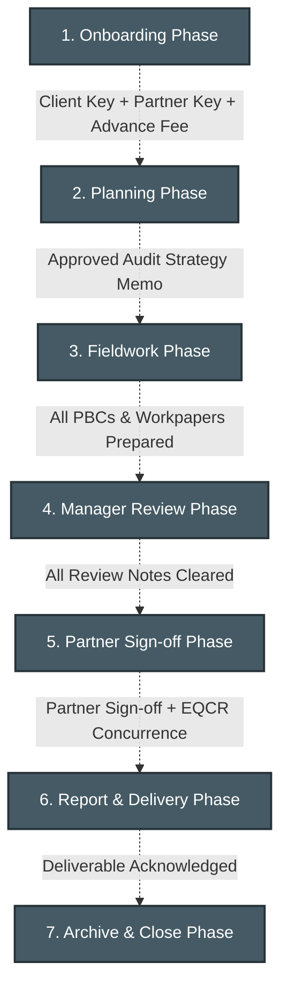
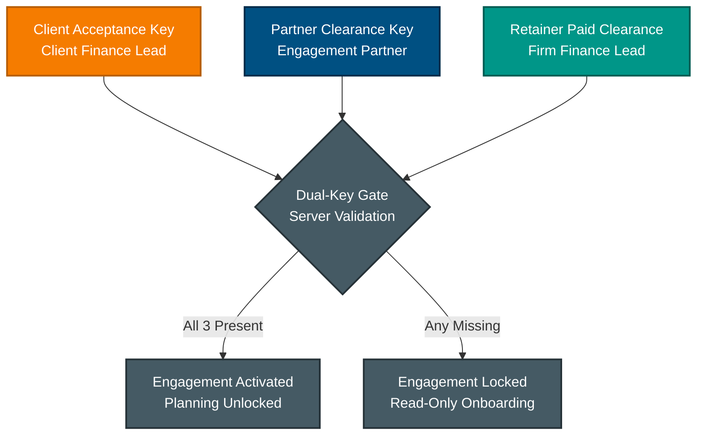
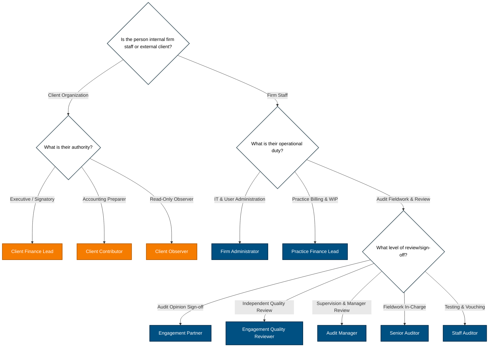
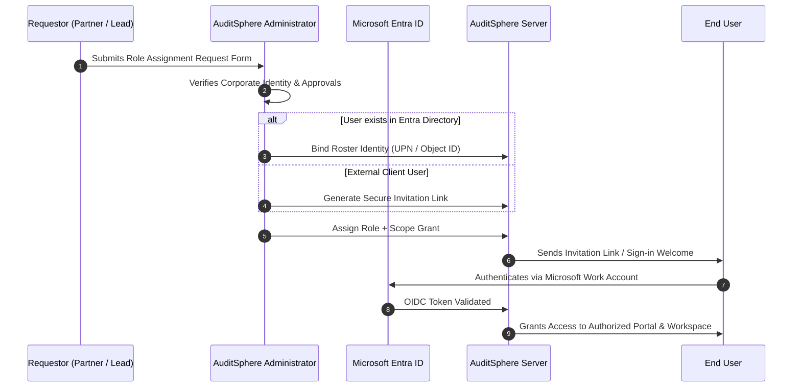

- **Screens Reached:** Users & Access, Roster Management, Directory Sync, Audit Log Viewer.
- **Access Termination:** Controlled by Firm Owner / Azure Entra Global Admin.

#### 7. Practice Finance Lead (`FIRM_FINANCE`)
- **Summary & Titles:** Finance Manager, Billing Coordinator, Practice Accountant.
- **Daily Responsibilities:** Engagement fee tracking, retainer/advance fee reconciliation, WIP analysis, and firm-wide invoicing.
- **What They Can Do:** Verify advance payments required for client activation; generate invoices; track project profitability.
- **What They Cannot Do:** Cannot modify audit working papers or sign off engagement phases.
- **Decisions Owned:** Commercial clearance and fee verification.
- **Handoffs & Review:** Confirms paid advance to trigger engagement activation alongside Dual-Key approvals.
- **Allowed Scopes:** `FIRM_WIDE`, `CLIENT`.
- **Screens Reached:** Firm Finance, Billing & Invoices, WIP & Retainers.
- **Access Termination:** Revoked by Administrator upon role change.

---

### Client Portal Roles

#### 8. Client Finance Lead (`CLIENT_PRIMARY`)
- **Summary & Titles:** Chief Financial Officer (CFO), Finance Director, Controller.
- **Daily Responsibilities:** Primary firm liaison, engagement terms acceptance, document fulfillment oversight, and deliverable receipt.
- **What They Can Do:** Execute Client Dual-Key engagement acceptance; assign client contributors to PBC requests; download signed audit deliverables.
- **What They Cannot Do:** Cannot alter firm workpapers; cannot view internal firm review notes.
- **Decisions Owned:** Formal acceptance of engagement scope and final deliverable receipt.
- **Handoffs & Review:** Hands off requested accounting records to Audit Team; receives final signed reports.
- **Allowed Scopes:** `CLIENT`, `ENGAGEMENT`.
- **Screens Reached:** Client Portal Dashboard, Dual-Key Approval, PBC Document Request Center, Deliverable Repository.
- **Access Termination:** Revoked upon client contract termination.

#### 9. Client Contributor (`CLIENT_CONTRIBUTOR`)
- **Summary & Titles:** Senior Accountant, Bookkeeper, Financial Analyst.
- **Daily Responsibilities:** Gathering and uploading requested accounting records, bank confirmations, invoices, and schedules.
- **What They Can Do:** Upload files against open PBC requests; respond to auditor clarifications.
- **What They Cannot Do:** Cannot sign engagement letters; cannot view billing/commercial data.
- **Decisions Owned:** Completeness of uploaded source records.
- **Handoffs & Review:** Submits uploaded evidence to Audit Staff.
- **Allowed Scopes:** `CLIENT`, `ENGAGEMENT`.
- **Screens Reached:** Document Upload Center, PBC Tracker.
- **Access Termination:** Expiry date reached or revoked by Client Finance Lead/Admin.

#### 10. Client Observer (`CLIENT_VIEWER`)
- **Summary & Titles:** Audit Committee Member, Board Director, Non-Executive Observer.
- **Daily Responsibilities:** Monitoring overall audit timeline and viewing final published reports.
- **What They Can Do:** Read-only access to published deliverable summaries and tracking dashboards.
- **What They Cannot Do:** Cannot upload documents, edit data, or approve deliverables.
- **Decisions Owned:** None.
- **Handoffs & Review:** Observes output delivered by Firm.
- **Allowed Scopes:** `CLIENT`, `ENGAGEMENT`.
- **Screens Reached:** Published Reports, Engagement Progress Tracker.
- **Access Termination:** Automatic expiry or revocation by Administrator.

---

## 5. Who Does What Across the Engagement Lifecycle

> **Crucial Rule:** In AuditSphere, the lifecycle phase is **derived automatically from underlying system evidence and cryptographic keys**, not manually toggled by checking off tasks.


*Diagram C: Engagement lifecycle phase gates derived from evidence.*

### Responsibility Matrix Across the 7 Phases

| Lifecycle Phase | Engagement Partner | Engagement Quality Reviewer (EQCR) | Audit Manager | Senior & Staff Auditor | Client Finance Lead | Client Contributor |
| :--- | :--- | :--- | :--- | :--- | :--- | :--- |
| **1. Onboarding** | Partner Risk Clearance Key | *Not Involved* | Scope setup assistance | *Not Involved* | Client Acceptance Key | Advance payment processing |
| **2. Planning** | Approves Audit Strategy | Reviews planned risk model | Drafts Strategy & Materiality | Compiles initial TB & PBC List | Confirms timetable | Receives PBC requests |
| **3. Fieldwork** | Monitors major escalations | *Not Involved* | Fieldwork oversight | Substantive vouching, testing | Coordinates PBC fulfillment | Uploads requested files |
| **4. Manager Review** | Interim risk assessment | *Not Involved* | Detailed review, review points | Resolves review points | Responds to queries | Submits missing files |
| **5. Partner Sign-off** | Final audit opinion sign-off | Formal EQCR Concurrence | Clears final workpaper checks | Final checks | Reviews draft report | *Not Involved* |
| **6. Report & Delivery**| Releases deliverable | Files review memorandum | Monitors delivery receipt | *Not Involved* | Downloads final signed report | *Not Involved* |
| **7. Archive & Close** | Engagement lock confirmation| Final archival check | File preparation | *Not Involved* | Read-only access retained | *Not Involved* |

---

## 6. Approvals and Separation of Duties

To protect audit integrity and comply with professional standards (ISQC 1 / ISQM 1 / ISA 220), AuditSphere enforces strict server-side separation-of-duties rules:

1. **Dual-Key Engagement Acceptance (M1-03):** An engagement will not transition into active planning until three conditions are met:
   - **Key 1:** Client Finance Lead submits digital acceptance of the engagement letter.
   - **Key 2:** Engagement Partner submits risk, independence, and technical clearance.
   - **Financial Gate:** Practice Finance confirms receipt of the agreed-upon retainer/advance.
2. **No Self-Review (Preparer ≠ Reviewer):** The user who prepares a working paper, reconciles a trial balance line, or uploads an audit test cannot approve or sign off on that same item.
3. **Partner-Only Authorities:** Only an authenticated user holding the `ENGAGEMENT_PARTNER` role can execute final opinion sign-off, risk overrides, and formal release.
4. **Administrator Separation:** A `ADMINISTRATOR` can manage user accounts and system configuration, but server rules prohibit administrators from signing audit documents, viewing restricted client working papers, or bypassing audit controls.
5. **Independent Quality Review (M2-02):** The `QUALITY_REVIEWER` must have zero operational role on the engagement team. Server-side logic prevents assigning an individual as both Engagement Partner and EQCR on the same engagement.


*Diagram D: Dual-key activation enforcement flow.*

---

## 7. Role vs Capability Matrix

| Module Name | Engagement Partner | Quality Reviewer (EQCR) | Audit Manager | Senior Auditor | Staff Auditor | Firm Admin | Practice Finance | Client Lead | Client Contributor | Client Observer |
| :--- | :---: | :---: | :---: | :---: | :---: | :---: | :---: | :---: | :---: | :---: |
| **Practice & Commercial** | **Full** | None | View | None | None | View | **Full** | None | None | None |
| **Workflow & Tasks** | **Full** | View | **Full** | **Full** | Assigned | View | None | None | None | None |
| **Client Accounting & Reporting** | **Full** | View | **Full** | **Full** | Edit | None | None | View | Upload | View |
| **Audit & Records** | **Full** | Concur | Review | Review | Prepare | None | None | None | None | None |
| **Firm Finance** | View | None | None | None | None | None | **Full** | None | None | None |
| **People & Time** | View | None | Edit | Enter | Enter | View | **Full** | None | None | None |
| **Group Consolidation** | **Full** | View | **Full** | Edit | View | None | None | None | None | None |
| **Client Portal** | View | None | View | View | View | Admin | None | **Full** | Upload | View |
| **Administration** | None | None | None | None | None | **Full** | None | None | None | None |
| **Knowledge Library** | View | View | View | View | View | **Full** | View | None | None | None |

**Legend:**
- **Full:** Complete create, read, update, delete, and execution authority.
- **Edit / Prepare:** Ability to input data, upload workpapers, and edit assigned tasks.
- **Review:** Ability to review work submitted by others and raise review notes; cannot self-approve.
- **Concur:** EQCR review and formal concurring approval; independent from preparation.
- **Upload:** Limited to uploading files against designated PBC requests.
- **View:** Read-only access within authorized scope.
- **None:** No access to routes, APIs, or data.

---

## 8. Which Role Should This Person Have?

Follow this decision tree to determine the exact role to request for a user:


*Diagram E: Role selection decision tree.*

---

## 9. How to Fill in the Request Form

When submitting access requests, ensure:
1. **Work Email:** Must match the exact corporate email account the user utilizes to authenticate against Microsoft Entra ID. Personal email domains (`@gmail.com`, `@yahoo.com`) are rejected by server validation.
2. **Account Type:** Specify either `Staff` or `Client`.
3. **Scope Specification:** Must specify the exact entity name or engagement code (e.g., `Client: Acme Corp` or `Engagement: ACM-2026-AUD`).
4. **Expiry Date:** Mandatory for temporary contractor auditors or interim client staff.

### Worked Example

| Full Name | Work Email | Staff or Client | Role Requested | Scope | Start Date | Expiry (if temp) | Approved By | Notes |
| :--- | :--- | :--- | :--- | :--- | :--- | :--- | :--- | :--- |
| Sarah Jenkins | `sarah.jenkins@example.com` | Staff | `ENGAGEMENT_PARTNER` | Client: Acme Corp | 2026-11-01 | *Permanent* | J. Managing Partner | Engagement Signing Partner |
| Marcus Vance | `marcus.vance@example.com` | Staff | `QUALITY_REVIEWER` | Engagement: ACM-2026-AUD | 2026-11-01 | 2027-03-31 | J. Managing Partner | Independent EQCR |
| Elena Rostova | `elena.rostova@example.com` | Staff | `AUDIT_MANAGER` | Engagement: ACM-2026-AUD | 2026-11-01 | *Permanent* | S. Jenkins (Partner) | Fieldwork Supervisor |
| David Chen | `david.chen@client-example.com`| Client | `CLIENT_PRIMARY` | Client: Acme Corp | 2026-11-01 | *Permanent* | S. Jenkins (Partner) | CFO / Acceptance Signatory |

---

## 10. What Happens After You Reply


*Diagram F: End-to-end access provisioning sequence.*

---

## 11. Changing or Removing Access

- **Offboarding & Employee Departures:** Notify the Firm Administrator immediately upon an employee or contractor departure. When an identity is disabled in Microsoft Entra ID, AuditSphere session tokens expire immediately.
- **Role Revocation:** An Administrator can revoke an active role grant in the **Users & Access** module with immediate effect.
- **Grant Expiry:** When a temporary grant reaches its specified expiry date, access is automatically severed by server authorization guards at midnight UTC.
- **Audit Logging:** Every grant, role change, scope modification, and revocation is written to an immutable PostgreSQL append-only audit trail recording the timestamp, acting administrator, and target user.

---

## 12. Frequently Asked Questions (FAQ) & Glossary

### FAQ

#### Q1: Can a Firm Administrator sign off on an audit report if the Partner is on leave?
**No.** AuditSphere enforces strict server-side separation of duties. Administrator access allows managing users and system configurations, but confers zero partner authority.

#### Q2: Can a Senior Auditor approve their own workpapers?
**No.** The system prevents self-review. All workpapers prepared by a Senior or Staff Auditor must be reviewed and cleared by another user (Manager or Partner).

#### Q3: Why does our engagement dashboard show "Read-Only / Pending Activation"?
The engagement has not satisfied the Dual-Key activation requirement. Check that (1) the Client Finance Lead has submitted digital acceptance, (2) the Engagement Partner has submitted risk clearance, and (3) Practice Finance has marked the advance retainer as received.

#### Q4: What happens if our organization disables Microsoft Graph B2B Guest Invitations?
If automated guest invitations are blocked by tenant policy (`BLOCKED_EXTERNAL`), the Administrator uses the manual "Copy Invitation Link" workflow in the Users & Access screen to send the onboarding token directly to the user.

#### Q5: Can an auditor work on two different engagements with different roles?
**Yes.** Roles are granted per scope. For example, a professional may act as an `AUDIT_MANAGER` on Engagement A, and as an independent `QUALITY_REVIEWER` on Engagement B.

#### Q6: Can a client contributor see billing and fee details?
**No.** Client Contributors are restricted exclusively to uploading evidence and viewing open PBC requests. Commercial details are visible only to the Client Finance Lead and Practice Finance.

#### Q7: What Microsoft Entra credentials do users log in with?
Users log in using their normal corporate Microsoft work email and password (with your organization's existing Multi-Factor Authentication). AuditSphere never stores or processes user passwords.

#### Q8: How long does an invitation link remain valid?
Invitation links remain valid for 7 days (`TO CONFIRM`). If a link expires, the Administrator must reissue an invitation from Users & Access.

### Glossary
- **Scope:** The operational boundary (Firm-Wide, Group, Client, or Engagement) within which a role grant is valid.
- **Grant:** An active, authenticated authorization binding a user identity, a role, and a scope together.
- **Engagement:** A distinct project instance (such as a 2026 Financial Statement Audit) with its own team, workpapers, and deliverables.
- **PBC (Provided by Client):** Audit evidence items requested from the client's accounting team.
- **TB / GL:** Trial Balance and General Ledger extracts used for substantive testing.
- **SRM (Strategy & Risk Model):** The foundational planning module where materiality and audit risks are recorded.
- **Dual-Key Acceptance:** The mandatory prerequisite gate requiring both client acceptance and partner technical clearance before active audit work can begin.
- **EQCR:** Engagement Quality Control Reviewer; an independent partner who evaluates significant judgments.

---

## 13. Appendices

### Appendix A: Users & Access Walkthrough (Administrator Only)

> *This section is reserved for AuditSphere Administrators operating in `AuditSphereOps.Ui`.*

#### 1. Navigating to Access Management
1. Log in to the Staff Portal using an account with `ADMINISTRATOR` authority.
2. Select **Administration** from the left-hand navigation menu.
3. Click **Users & Access** (`/admin/access`).

#### 2. Search Local Users & Roster Binding
- Use the **Search Local Users** bar to locate existing user profiles by name, email, or Entra User Principal Name (UPN).
- To bind a new corporate employee whose details have been loaded into the roster:
  1. Click **Bind a Roster Identity**.
  2. Input the corporate email address.
  3. Enter the Microsoft Entra Object ID (UUID) if direct directory integration is enabled.
  4. Click **Confirm Binding**.

#### 3. Assign Role and Scope Dialog
1. Locate the verified user record and click **Assign Role & Scope**.
2. **Account Type:** Select `Staff` or `Client`.
3. **Role:** Select the verified code identifier from the dropdown (e.g., `AUDIT_MANAGER`).
4. **Scope Level:** Choose `FIRM_WIDE`, `GROUP`, `CLIENT`, or `ENGAGEMENT`.
5. **Target Identifier:** Select the specific Client or Engagement from the search selector.
6. **Grant Duration:** Choose `Permanent` or specify an `Expiry Date`.
7. Click **Save Grant**. The server will generate an audit event and activate the permissions immediately.

#### 4. Copy Invitation Link & External Invitations
- When onboarding external client users where Microsoft Graph automated guest provisioning is disabled (`GUEST_INVITATION` disabled):
  1. Click **Generate External Invitation**.
  2. Enter the client contact's corporate email and full name.
  3. Assign the initial scope (`Client: <Name>`).
  4. Click **Copy Invitation Link**.
  5. Distribute this single-use link to the client via secure communication.

---

### Appendix B: Evidence Map & Traceability

This appendix documents the codebase source paths and symbols establishing the authoritative truth for each role and privilege.

| Role Display Label | Code Identifier | Code Implementation File Reference | Enforced Server Guard / Policy |
| :--- | :--- | :--- | :--- |
| **Engagement Partner** | `ENGAGEMENT_PARTNER` | `src/AuditSphereOps.Domain/Identity/Roles.cs`<br/>`src/AuditSphereOps.Ui/src/app/features/admin/roles.ts` | `RequirePartnerAuthorityPolicy`<br/>`DualKeyPartnerSignOffCommand` |
| **Engagement Quality Reviewer** | `QUALITY_REVIEWER` | `src/AuditSphereOps.Domain/Identity/Roles.cs`<br/>`docs/requirements/auditsphere-accounting-module-requirements-current.md#M2-02` | `RequireIndependentQualityReviewer`<br/>`EnsurePreparerNotReviewerRule` |
| **Audit Manager** | `AUDIT_MANAGER` | `src/AuditSphereOps.Domain/Identity/Roles.cs`<br/>`src/AuditSphereOps.Application/Workflows/WorkpaperReviewCommand.cs` | `RequireManagerOrPartnerGuard` |
| **Senior Auditor** | `SENIOR_AUDITOR` | `src/AuditSphereOps.Domain/Identity/Roles.cs`<br/>`src/AuditSphereOps.Ui/src/app/features/admin/access-contracts.ts` | `FieldworkLeadPermission` |
| **Staff Auditor** | `STAFF_AUDITOR` | `src/AuditSphereOps.Domain/Identity/Roles.cs`<br/>`src/AuditSphereOps.Application/Workpapers/CreateWorkpaperCommand.cs` | `EnsurePreparerNotReviewerRule` |
| **Firm Administrator** | `ADMINISTRATOR` | `src/AuditSphereOps.Domain/Identity/Roles.cs`<br/>`src/AuditSphereOps.Ui/src/app/features/admin/access.ts` | `RequireAdminRolePolicy` (Server denies audit sign-off) |
| **Practice Finance Lead** | `FIRM_FINANCE` | `src/AuditSphereOps.Domain/Identity/Roles.cs`<br/>`src/AuditSphereOps.Application/Commercial/AdvancePaymentHandler.cs` | `RequireFinanceRolePolicy` |
| **Client Finance Lead** | `CLIENT_PRIMARY` | `src/AuditSphereOps.Domain/Identity/Roles.cs`<br/>`docs/requirements/auditsphere-accounting-module-requirements-current.md#M1-03` | `DualKeyClientAcceptanceCommand` |
| **Client Contributor** | `CLIENT_CONTRIBUTOR` | `src/AuditSphereOps.Domain/Identity/Roles.cs`<br/>`src/AuditSphereOps.Application/Pbc/UploadPbcEvidenceCommand.cs` | `ClientPbcUploadScopeGuard` |
| **Client Observer** | `CLIENT_VIEWER` | `src/AuditSphereOps.Domain/Identity/Roles.cs`<br/>`src/AuditSphereOps.Ui/src/app/routes/app.routes.ts` | `ClientReadOnlyScopeGuard` |

#### Open Questions & Items Marked `TO CONFIRM`
1. `TO CONFIRM-01`: Exact token validity period for client onboarding invitation links (default documented as 7 calendar days).
2. `TO CONFIRM-02`: Entra ID background group synchronization frequency when `GROUP_MEMBERSHIP` automated sync is enabled.
3. `TO CONFIRM-03`: Allowed character constraints and domain whitelist rules for external client email domains in multi-tenant environments.
```

---

# Deliverable D2: Self-Contained Single-File HTML Version

```html
<!-- File: docs/user-guides/auditsphere-user-guide-roles-and-access-current.html -->
<!DOCTYPE html>
<html lang="en">
<head>
  <meta charset="UTF-8">
  <meta name="viewport" content="width=device-width, initial-scale=1.0">
  <title>AuditSphere Roles & Access Guide</title>
  <style>
    :root {
      --bg-primary: #ffffff;
      --bg-secondary: #f8fafc;
      --bg-card: #ffffff;
      --text-primary: #0f172a;
      --text-secondary: #475569;
      --border-color: #e2e8f0;
      --primary: #005082;
      --primary-light: #e6f0f7;
      --client-accent: #f57c00;
      --accent: #009688;
      --warning-bg: #fffbeb;
      --warning-border: #fef3c7;
      --warning-text: #92400e;
      --code-bg: #f1f5f9;
      --shadow: 0 1px 3px 0 rgb(0 0 0 / 0.1), 0 1px 2px -1px rgb(0 0 0 / 0.1);
      --font-main: -apple-system, BlinkMacSystemFont, "Segoe UI", Roboto, Helvetica, Arial, sans-serif;
    }

    @media (prefers-color-scheme: dark) {
      :root {
        --bg-primary: #0f172a;
        --bg-secondary: #1e293b;
        --bg-card: #1e293b;
        --text-primary: #f8fafc;
        --text-secondary: #94a3b8;
        --border-color: #334155;
        --primary: #38bdf8;
        --primary-light: #082f49;
        --client-accent: #fb923c;
        --accent: #2dd4bf;
        --warning-bg: #451a03;
        --warning-border: #78350f;
        --warning-text: #fde68a;
        --code-bg: #0f172a;
        --shadow: 0 1px 3px 0 rgb(0 0 0 / 0.3);
      }
    }

    * { box-sizing: border-box; margin: 0; padding: 0; }
    body {
      font-family: var(--font-main);
      background-color: var(--bg-primary);
      color: var(--text-primary);
      line-height: 1.6;
      font-size: 16px;
      display: flex;
    }

    /* Layout */
    .toc-sidebar {
      width: 280px;
      position: sticky;
      top: 0;
      height: 100vh;
      overflow-y: auto;
      background: var(--bg-secondary);
      border-right: 1px solid var(--border-color);
      padding: 1.5rem 1rem;
      flex-shrink: 0;
    }
    .toc-sidebar h3 { font-size: 1.1rem; margin-bottom: 1rem; color: var(--primary); }
    .toc-sidebar ul { list-style: none; }
    .toc-sidebar li { margin-bottom: 0.5rem; }
    .toc-sidebar a {
      color: var(--text-secondary);
      text-decoration: none;
      font-size: 0.9rem;
      display: block;
      padding: 0.25rem 0.5rem;
      border-radius: 4px;
    }
    .toc-sidebar a:hover {
      background: var(--primary-light);
      color: var(--primary);
    }

    .main-content {
      flex: 1;
      padding: 2rem 3rem;
      max-width: 1000px;
    }

    h1, h2, h3, h4 { color: var(--text-primary); font-weight: 700; margin: 1.5rem 0 0.75rem 0; }
    h1 { font-size: 2.2rem; border-bottom: 2px solid var(--border-color); padding-bottom: 0.5rem; }
    h2 { font-size: 1.6rem; border-bottom: 1px solid var(--border-color); padding-bottom: 0.4rem; margin-top: 2rem; }
    h3 { font-size: 1.25rem; }
    p { margin-bottom: 1rem; color: var(--text-secondary); }

    .callout {
      background: var(--warning-bg);
      border-left: 4px solid var(--client-accent);
      padding: 1rem 1.25rem;
      border-radius: 4px;
      margin: 1.5rem 0;
      color: var(--warning-text);
    }
    .callout strong { display: block; margin-bottom: 0.25rem; }

    /* Tables */
    table {
      width: 100%;
      border-collapse: collapse;
      margin: 1.5rem 0;
      font-size: 0.95rem;
    }
    th, td {
      border: 1px solid var(--border-color);
      padding: 0.75rem 1rem;
      text-align: left;
    }
    th {
      background: var(--bg-secondary);
      color: var(--text-primary);
    }

    /* Collapsible Role Cards */
    details.role-card {
      background: var(--bg-card);
